> 这篇拆的是 Anthropic 工程师 Vivek Nair 2026 年 11 月 17 日发在 claude.dev 博客上的《Using a "chaos loop" to harden the Claude Docs launch》。一句话概括：**上线前两周，让 Claude Code 在预发环境里不停地“搞破坏、读遥测、提修复”，人只在难撤销的决策上拍板。** 我按“先动手、紧跟机理”的方式，把它改写成 9 步，并全程用一个充电桩后台（CSMS）的例子来落地。

**阅读约定**

- 标 ✅ 的：原文或 Anthropic 官方文档里写明的事实、数字、配置语法（2026-11-23 核对）。
- 标 ⚠️ 的：作者自己补的示例——充电桩场景、OCPP 报文、脚本名、阈值都是教学虚构，按你的工程调整。
- 英文引文每处不超过 25 个词，出处见文末。



*图 0：前 4 步是开跑前人来立规矩，后 5 步让循环转起来，人只在关键处把关。*

---

## 先把故事和几个词讲清楚

**故事（✅ 均出自原文）**：Claude Docs 是一个你、同事和 Claude 一起编辑的文档服务，2026 年 9 月 16 日上线。上线前三周它还只是跑在单节点上、几千名内部员工在用的原型。作者在 9 月 4 日让 Claude 驱动一个镜像生产环境的预发（staging）集群，每天灌入一百多万份合成文档，并故意弄坏核心组件——然后“就让它一直跑着”。结果：

| 指标 | 原文数字 |
| --- | --- |
| 上线到 9 月 22 日新建文档 | 超过 460 万 |
| 请求量 / 服务端错误 | 20 亿次请求，只有 60 次服务端错误 |
| 回滚 | 9 月生产环境发布 629 次，一次没回滚 |
| 资源 | 全服务约 50 个内存优化型 pod（原估算 500 个以上） |
| 推理花费 | 按 Claude Fable 5.2 标价约 12.5 万美元（8 月底到上线日） |

**几个 Agent 术语，用固件工程师的话说：**

- **Agent（智能体）**：一个循环——模型决定调用什么工具（跑命令、读文件、查监控），工具结果再喂回模型，直到任务完成。像 ESP32 主循环里的状态机：读输入、决策、执行、再读结果。
- **Harness（运行框架/驾驭层）**：包在模型外面、决定它能看到什么、能做什么、怎么循环的那层代码和配置。原文里的“test harness”则特指压测框架。
- **上下文窗口 / 压缩（compaction）**：模型一次能“看见”的文本有上限；会话太长时，系统会把旧内容压缩成摘要继续跑。摘要是有损的。
- **子代理（subagent）**：主会话派出去的、拥有自己独立上下文的小 Agent，干完把结果交回来。
- **MCP（Model Context Protocol）**：给 Agent 接外部工具的标准接口。原文用它接 Datadog（监控）和 Slack。
- **遥测（telemetry）**：服务自己上报的指标、日志、链路追踪——相当于固件里的串口日志 + 心跳里的状态字段。

为什么值得读？Anthropic 之前在《Effective harnesses for long-running agents》里坦言，让 Agent 跨多个上下文窗口持续推进“仍是一个开放问题”；这篇则是一个真实、有花费账单的长任务案例，而且它的成败几乎全靠**人设定的边界和遥测的可读性**，而不是靠模型“自己聪明”。

---

## 第 1 步：开跑前，把“不变量”写成文件

**动手做**

原文最后的清单里有一条 ✅：开始前，写下你最重要的技术不变量（invariants），交给 Claude。Claude Docs 只有两条 ✅：

1. 文档必须几乎瞬开，即使历史很长；
2. 服务器一旦确认了某次编辑，测试里这次编辑就必须还在。

换成充电桩后台 ⚠️，在仓库里建 `docs/invariants.md`：

```markdown
# CSMS 不变量（任何改动都不得违反）
1. CSMS 一旦对 StopTransaction / MeterValues 回了 CALLRESULT，
   这笔交易与电量数据之后必须能从数据库查到（“已确认的不丢”）。
2. 任意时刻，充电桩发来的 BootNotification 都要在 <你们定的秒数> 内得到响应，
   即使有大量桩同时重连。
```

再在项目根目录的 `CLAUDE.md` 里 ✅ 用 `@` 导入它：

```markdown
## 不变量
@docs/invariants.md
每轮修改前后，都要说明本次改动如何保持上述不变量。
```

**机理：为什么要写成文件，而不是在对话里说一遍**

- 原文“Why this works now”一节 ✅：几个月前的模型，迭代到第 10～20 轮就会开始忘记在优化什么，作者只好反复重申目标，Anthropic 内部把这叫 **goal drift（目标漂移）**。而新模型 "held all of our invariants across many compactions, and I never had to repeat them."
- 为什么会漂移？Anthropic 在《A harness for every task》里解释：漂移在压缩后尤其明显，"Each summarization step is lossy"，像“边界条件”“不要做 X”这种细节最容易丢 ✅。
- 为什么放进 `CLAUDE.md`？Claude Code 文档写明 ✅：项目根目录的 CLAUDE.md 在 `/compact` 之后会从磁盘重新读取、重新注入；只在对话里说过的指令，压缩后可能就没了。这和 ESP32 上把关键参数放 NVS 而不是放 RAM 是一个道理：掉电（压缩）后还能读回来。
- 文档还建议 ✅ 每个 CLAUDE.md 控制在 200 行以内，越长越占上下文、遵守度越低——所以不变量要少而硬，两三条就够，原文也只有两条。

**Anthropic 式关注点**

- 🛡 安全边界：不变量是“红线”，不是“愿望”。它们应能被测试自动判定（第 6 步会让压测脚本直接检查它们）。
- 👀 可观测：要求 Claude 每轮写明“本次改动如何保持不变量”，你翻日志就能核对它是否还记得。
- ⚠️ 失败模式：跳过这步，长循环几十轮后 Agent 可能为了降内存而牺牲“已确认不丢”——局部指标变好，全局目标被悄悄换掉。

---

## 第 2 步：划出“难撤销”的边界，让 Claude 停下来问你

**动手做**

原文 ✅：开跑前作者告诉 Claude 哪些决策必须经他批准——"basically anything hard to undo, like changing the database schema or key layout"，以及文档的存储和物化方式。遇到这类决策，Claude 会停下来问他，通常附带一个推荐方案。

落地分两层。**软边界**写进 `CLAUDE.md` ⚠️：

```markdown
## 需要我批准的决策（难撤销）
- 改数据库表结构、索引、分区键
- 改交易记录 / 电量数据的存储格式
- 任何对生产环境的操作
遇到这些：停下，给我 2–3 个方案和你的推荐，等我选。
其余易撤销的改动：自己写、部署到预发、重跑压测。
```

**硬边界**写进 `.claude/settings.json`，用 Claude Code 的权限规则 ✅（语法见官方 Permissions 文档）和 PreToolUse 钩子 ✅（语法见 Hooks 文档）：

```json
{
  "permissions": {
    "ask":  ["Bash(psql *)", "Bash(kubectl apply *)"],
    "deny": ["Bash(kubectl --context prod *)", "Bash(git push *)"]
  }
}
```

⚠️ 上面的具体命令是示例；`ask`/`deny` 的格式与“`*` 放在子命令之后”的写法是文档里的。注意文档也提醒 ✅：同一操作换个写法（例如 `git -C . push`）可能匹配不到规则，所以硬边界最好再配合沙箱或独立凭证，别只靠字符串匹配。

再加一个 PreToolUse 钩子，专门拦“直连生产”的命令。配置结构 ✅ 照抄 Hooks 文档，脚本内容 ⚠️ 为示例：

```json
{
  "hooks": {
    "PreToolUse": [
      {
        "matcher": "Bash",
        "hooks": [
          { "type": "command", "command": "${CLAUDE_PROJECT_DIR}/.claude/hooks/no-prod.sh" }
        ]
      }
    ]
  }
}
```

```bash
#!/bin/bash
# .claude/hooks/no-prod.sh：命令里出现生产 CSMS 地址就拦下（退出码 2 = 阻止，stderr 会作为原因交给 Claude）
command=$(jq -r '.tool_input.command')
if [[ "$command" == *"csms-prod."* ]]; then
  echo "Blocked: 混沌循环只允许操作 staging" >&2
  exit 2
fi
exit 0
```



*图 1：硬边界由 Claude Code 强制执行，软边界靠模型遵守——两层都要有，软边界还要靠日志核对。*

**机理：为什么只拦“难撤销”，而不是什么都要审批**

- 人的注意力是最稀缺的检查资源。Anthropic 在《How we built Claude Code auto mode》里给过一个数字 ✅：手动审批模式下 "in practice users accept 93% of them anyway"，这会导致“审批疲劳”，人不再认真看自己批了什么。
- 所以原文的做法是把人放在**代价不对称**的地方：改表结构这类事“通常有几种合理答案，而换方向往往很痛苦” ✅；而缓存大小、查询改写这类改动，下一轮压测就能验证、不对就撤。
- 为什么还要硬边界？auto mode 那篇列举过 Agent “过度热心”的真实案例 ✅，例如部署前置检查失败后，Agent 带着跳过校验的参数重试。CLAUDE.md 是模型“读了会遵守”的约定，权限规则和钩子是“做不到”的机制。文档写明 ✅：钩子返回 allow 也绕不过 deny/ask 规则。
- 充电桩类比 ⚠️：这就像 OTA 升级——改一个日志级别可以远程随便推，但改分区表、改 NVS 数据格式，必须有人签字，因为桩一旦起不来就要上门。

**Anthropic 式关注点**

- 🛡 人工检查点：只设在“难撤销 × 影响大”的交叉点上，而且要求 Claude 带推荐来，减少你的决策成本。
- 👀 可观测：被 deny/钩子拦下的动作，Claude 会收到拒绝原因 ✅；你也该定期翻会话记录，看它有没有绕着规则走。
- ⚠️ 失败模式：只写软边界——某次压缩后约定丢了、或模型“好心”替你做了决定；全都设成 ask——你会在第 200 次弹窗时闭眼点同意。

---

## 第 3 步：把遥测接给 Claude（MCP）

**动手做**

原文清单第一条 ✅：让 Claude 能访问你的遥测，大多数可观测性服务商都有 Claude 可用的 MCP 服务器。原文用的是 Datadog MCP。接入命令格式 ✅：

```bash
claude mcp add --transport http <name> <url>
```

`<url>` 以你所用监控平台的官方 MCP 文档为准，这里不编造地址。接入后，在权限里只放行它的**只读**查询工具 ⚠️（规则格式 `mcp__<server>__<tool>` 见官方文档 ✅）。

然后，让服务的每个操作都带上 Claude 读得懂的遥测。原文 ✅：每条数据库查询都上报**查询名**和**扫描行数 vs 返回行数**，Claude 据此发现坏查询并重写。CSMS 版本 ⚠️：

```text
op=meter_values.insert  cp_id=CP-0421  rows_scanned=1  rows_returned=1  ms=3
op=tx.lookup_by_idtag   cp_id=CP-0421  rows_scanned=184022  rows_returned=1  ms=412   ← 一眼看出缺索引
```

**机理：Agent 只能修它“看得见”的问题**

- 原文开头就说 ✅：Claude 只有在系统每轮都产出准确遥测时，才能有效地“闭环”修复。没有遥测，Agent 只能根据代码猜，猜完也无法验证。
- “扫描行数 vs 返回行数”是一个**自带判据**的信号：比值越离谱越可疑，不需要 Agent 理解整个业务就能定位。这和 Anthropic《How the Claude Code team thinks about verification》的思路一致：给 Agent 能拿到证据的手段，才能放心把更多工作交给它 ✅。
- 为什么监控 MCP 只给只读？Agent 读遥测是为了诊断，不需要改告警、删仪表盘；最小权限能让“过度热心”的动作根本无从发生 ⚠️（作者建议，对应 auto mode 文中“按真实影响评估动作”的原则）。

**Anthropic 式关注点**

- 👀 可观测是双向的：Claude 看遥测，你看 Claude 读了哪些遥测、据此提了什么——在会话记录里都能回溯。
- ⚠️ 失败模式：遥测含用户数据。原文验证那篇举过例子 ✅：如果 Agent 反复挂在“检查日志里有没有用户数据”的测试上，就该加钩子或在 CLAUDE.md 里写更明确的规则。充电桩里，idTag（卡号）就属于这类数据 ⚠️。

---

## 第 4 步：挑一套“Claude 量得清”的技术栈

**动手做**

原文清单 ✅：选栈时，偏向 Claude 最容易测量的东西——对他们来说是 Rust 加尽可能少的依赖。少数必须的依赖，他们把代码 vendor（拷进仓库）以便自己读、自己量。

对充电桩团队 ⚠️：

- 后台（CSMS）：新服务选型时，把“内存/延迟能否追溯到自己的代码”列为一个评估项。
- 固件（ESP32）：C 写的 ESP-IDF 工程本来就没有垃圾回收，但第三方组件（WebSocket、JSON 库等）的堆分配你未必看得清。可以把关键组件放进工程的 `components/` 里固定版本，并在诊断日志里周期性打印 `heap_caps_get_free_size()` 和 `heap_caps_get_minimum_free_size()`，让 Agent 能把“堆变少”对应到具体模块。



*图 2：原文的选择是让每个数字都能追溯到自己写的代码；避开的那条路是“赌”，不是“测”。*

**机理：模型靠干净信号“爬坡”**

- 原文原话 ✅："our models hill climb best with a clean signal." 爬坡（hill climb）就是“改一点、量一下、变好就保留”。如果垃圾回收器按自己的节奏让内存和延迟起伏，Agent 就分不清是自己的改动起了作用，还是噪声。
- 有了 Rust（无 GC），文档的内存都在他们定义的结构里，内存涨了 Claude 能指出是哪一个结构、改掉、下一轮看有没有降 ✅。
- 工程审慎 ✅：作者明确说他们**没有**对比 Go 和 Rust，这只是他们的经验；他们内部 Go 工具链也很好。原文还提到，Rust 对人难写，几年前这会是重大顾虑，但现在 Claude 能写，这个顾虑小了很多。所以别把这一条读成“必须换 Rust”，要读成“**可测量性是一项一等的选型标准**”。

**Anthropic 式关注点**

- ⚠️ 失败模式：信号噪声大时，Agent 会把随机波动当成改进保留下来，几十轮后代码里积累一堆“看起来有用”的无效改动。验证那篇也警告过 ✅：测试不稳定，会教会 Agent 重跑测试而不是修代码。

---

## 第 5 步：让 Claude 写压测脚本，在预发里“故意搞破坏”

**动手做**

原文清单 ✅：让 Claude 写一个负载脚本，对服务的预发副本施加**十倍于真实流量**的压力，并故意弄坏东西——杀掉一个实例、让数据库卡住、在流量尖峰中途部署，都是好的起点；然后让 Claude 持续修复任何倒下的东西。

原文挑的“偏执”场景 ✅，和充电桩后台的对应 ⚠️：



*图 3：左边是原文的三个压测场景，右边是作者为充电桩后台改写的对应场景。*

给 Claude 的提示词示例 ⚠️：

```text
在 staging 命名空间里写一个 OCPP 1.6J 模拟器 scripts/chaos/sim_cp.py：
- 模拟 N 个充电桩，按真实峰值的 10 倍发 Heartbeat、StatusNotification、MeterValues；
- 场景 A：重启 CSMS，让所有模拟桩同时重连并发 BootNotification；
- 场景 B：在处理 StartTransaction 期间杀掉一个 CSMS 实例，同时让数据库卡顿；
- 每个场景结束后，自动检查 docs/invariants.md 里的两条不变量，输出 PASS/FAIL。
只允许连接 staging 的地址；不要碰任何生产配置。
```

**机理：为什么是“十倍 + 故意破坏 + 只在预发”**

- 原文的动机 ✅：单机上几千个内部用户，说明不了服务能不能扛住上线；他们没有上线流量可用，想要**真实证据**来决定放量速度。没有压测，“能扛住”只是一个信念。
- 原文上线周的结果 ✅：预演过的 10 个场景里有 7 个真的在生产发生了，而那时修复早已就位。Claude 擅长想象服务会怎么失败——这正是让它来写“偏执场景”的理由。
- 为什么脚本里要自动判不变量？这让“通过/不通过”变成程序判断，而不是 Agent 自己说了算。Anthropic 验证那篇说 ✅："If a change can modify the check that judges it, the check is broken." 所以要把判据（不变量检查）和被测改动分开管理 ⚠️。
- 为什么只打预发？破坏性测试是这套方法里最危险的动作。auto mode 那篇讲过 ✅：默认情况下，分类器唯一信任的只是你当前所在的 git 仓库，其他都在信任边界外。对应到这里 ⚠️：把预发地址写进允许列表，生产凭证根本不要出现在 Agent 能读到的地方；必要时开启 Claude Code 沙箱 ✅，用 `sandbox.network.allowedDomains` 限制它只能连预发。

**Anthropic 式关注点**

- 🛡 安全边界：“十倍流量 + 杀实例”只在镜像生产的预发里做；任何指向生产的命令都在第 2 步的 deny 列表里。
- ⚠️ 失败模式：模拟器写得不像真桩（比如不按 OCPP 规定重试），压测就只是在测模拟器。让 Claude 写完后，先拿一台真桩或现有的协议测试工具对一遍报文 ⚠️。

---

## 第 6 步：跑“诊断循环”——读遥测、补遥测、撤掉错误猜测

**动手做**

启动一个长时间运行的 Claude Code 会话，给它的指令就是原文的循环 ✅：挑一个场景 → 跑压测框架 → 读遥测 → 提出修复 → 发到预发 → 重复。每一轮，Claude 读完遥测后给出“一个简短的方案菜单 + 推荐”；易撤销的就自己写、部署预发、重跑。



*图 4：一轮循环里，Claude 做大多数步骤，人在“选难撤销方案”和“批准”两处把关（根据原文图 1 与正文重绘）。*

关键动作是**让 Claude 边跑边补遥测** ✅：每一轮它都读遥测，并补上它认为缺的部分。原文的内存案例最能说明问题：



*图 5：第一猜是错的，下一轮数据推翻它，Claude 撤回改动、补更细的剖析，最终找到真因（数字均来自原文）。*

建议 ⚠️ 再加一个进度文件，借用《Effective harnesses for long-running agents》的做法 ✅（那篇里叫 `claude-progress.txt`，配合 git 提交记录让新上下文快速接手）：

```markdown
# docs/chaos-progress.md（每轮追加）
## 第 37 轮 · 场景 A（全网重连）
- 观察：BootNotification p99 超出阈值；tx.lookup_by_idtag 扫描 18 万行返回 1 行
- 假设：缺索引；方案：A 加索引（需批准，改表结构）/ B 加缓存（易撤销）；推荐 A
- 状态：等待人工决策
```

**机理：为什么“补遥测”和“撤回错误猜测”是核心**

- 原文 ✅：手写遥测很繁琐，所以过去遥测大多是出事之后才补；现在 Claude 边跑边写。这改变了诊断的经济学——补一个指标的成本从“人半天”变成“循环里顺手一步”。
- 内存案例的关键不是最后的写时复制，而是**中间那次撤回** ✅：Claude 的第一猜（缩小缓存）被下一轮数据证伪，于是撤掉改动。如果没有“每个改动都要被下一轮数据验证”的结构，这个无效改动就会留在代码里。
- 为什么要进度文件？长循环会经历多次上下文压缩。Anthropic 在长任务 harness 那篇里说，关键是让 Agent 在全新上下文里能“快速理解工作进展”，靠的是进度文件加 git 历史 ✅。对你来说，它同时是**审计日志**：哪一轮、为什么、谁批的，一目了然。

**Anthropic 式关注点**

- 👀 可观测：你不需要盯着循环，但要能在任意时刻回答“它现在在干什么、为什么”。进度文件 + 会话记录 + git log 就是答案。
- ⚠️ 失败模式：Agent 只报好消息。要求每轮写明“哪个假设被推翻了”，就像固件调试日志里要记录失败的尝试一样。

---

## 第 7 步：协调者 + 子代理 + 独立评审，而且不迷信“越多越好”

**动手做**

原文 ✅：那个长期运行的会话充当**协调者**，把大部分工作交给子代理；最忙的那周通常同时有大约 11 个子代理，峰值 30 个。协调者还通过 Slack MCP 联系了内部的 Claude Tag（beta），让其他做过类似扩容的基础设施团队的 Agent 检查他们的扩容思路有没有踩过的坑。原文图 1 还画出：改动由 Claude 在**另一个会话**里评审，再由人批准。



*图 6：协调者负责循环本身，子代理各自在独立上下文里干活，写修复和评审修复分开进行。*

在 Claude Code 里定义一个只读评审子代理 ✅（文件格式见 Subagents 文档；内容 ⚠️ 为示例），放在 `.claude/agents/chaos-reviewer.md`：

```markdown
---
name: chaos-reviewer
description: 评审混沌循环中产生的修复，对照 docs/invariants.md 检查，只读不改。
tools: Read, Grep, Glob
---
你是评审者。读取本轮 diff 和 docs/chaos-progress.md 的最新一条：
1. 逐条说明改动是否可能违反 docs/invariants.md；
2. 判断它是否属于“难撤销”类（表结构、存储格式），若是而未获批准，直接标红；
3. 指出缺少的遥测或测试。只输出结论和理由，不要修改任何文件。
```

**机理：为什么“写”和“评”要分开，为什么不是越多越好**

- 分开的理由，Anthropic 在《A harness for every task》里给了名字 ✅：**self-preferential bias（自我偏好）**——Claude 倾向于偏爱自己的结果，尤其在让它按标准评判自己时。独立上下文的子代理能缓解这一点，也能缓解长上下文里的目标漂移。
- 评审子代理只给 `Read, Grep, Glob`：工具清单就是它的能力边界，评审者物理上改不了被评审的东西——呼应验证那篇“改动不能修改评判它的检查” ✅。
- 但原文同样务实 ✅：如果协调者 + 子代理每小时烧的 token 太多，退回单个 Agent 也应该效果不错。验证那篇也说 ✅，与其叠加更多评审者，不如把主评审者调好。多 Agent 是放大手段，不是默认选项——这也呼应 Anthropic《Building effective agents》“先找最简单方案、确有需要再加复杂度”的建议。

**Anthropic 式关注点**

- 🛡 人工检查点：评审之后仍然是“你批准”——评审子代理是帮你筛，不是替你签。
- 👀 可观测：子代理的结论写回进度文件，避免“30 个子代理各干各的，没人知道全貌”。
- ⚠️ 失败模式：跨团队 Agent 交流（原文的 Slack MCP）意味着信息会流出你的仓库。⚠️ 在你自己的团队里，先确认哪些频道、哪些数据可以让 Agent 读写。

---

## 第 8 步：修复都藏在运行时开关后面，上线时人握着开关

**动手做**

原文 ✅：上线时，压测框架早已把预发折腾过一遍，Claude 已把修复放在**运行时开关（runtime flags）**后面发布；某部分基础设施吃紧时，他们通常“翻一下开关”就行。

CSMS 版本 ⚠️：

```yaml
# config/flags.yaml（示例）
boot_notification_rate_limit: true     # 全网重连时，对 BootNotification 排队限流
tx_lookup_cache: false                 # 第 37 轮的缓存方案，默认关，吃紧时再开
```

固件侧也有天然的对应 ⚠️：OCPP 1.6 的 `ChangeConfiguration` 可以远程改桩上的配置项，把新行为做成配置项、默认关闭，比直接 OTA 换行为更容易回退。

**机理：把“难撤销”变成“可撤销”**

- 第 2 步说人只盯难撤销的决策；第 8 步反过来，**把上线这件本来难撤销的事，拆成“发布代码”和“打开行为”两步**，后者一翻就回。原文 9 月在生产发布 629 次、零回滚 ✅——频繁发布之所以安全，前提是行为由开关控制、并且已在预发里演练过。
- 开关也是人类监督的界面：Agent 准备好选项，人在真实流量下决定何时打开。

**Anthropic 式关注点**

- 🛡 人类掌握最后一步：开关怎么翻、何时翻，由值班的人决定，并留下记录。
- ⚠️ 失败模式：开关越积越多、组合爆炸、没人敢删。⚠️ 建议在进度文件里给每个开关写上“来源轮次 + 预计删除时间”。

---

## 第 9 步：算账，并按自己的规模收缩

**动手做**

原文的账 ✅：

- 8 月底到上线日，按 Claude Fable 5.2 标价（2026 年 11 月）约 12.5 万美元推理费；作者估计这个量级的工作，几年前需要一组工程师约六个月。
- 大部分花在读遥测、写方案、生成修复和评审代码上。
- 作者坦言摸索流程时烧了很多 token，现在回头看大概能省一半。
- 换成“几台 Kubernetes 节点 + 一个 Postgres”的小团队栈，他剔除了不需要的工作后，大约剩三分之一的改动，估计两周冲刺约 3,000～10,000 美元——但他说 "I haven't actually run this, so it's only a rough sense"。

在 Claude Code 里，用 `/usage` 查看当前会话的 token 用量 ✅（详见 Costs 文档）。⚠️ 建议在进度文件里每天记一次用量，和“修掉的问题数”放在一起看。

**机理：为什么成本也是安全问题的一部分**

- 长任务失控的第一个信号往往是成本：循环空转、子代理重复劳动、同一个错误猜测反复尝试。把用量和产出放在一起看，本身就是一种可观测性。
- 原文对数字的态度值得学：实测的（12.5 万）和估计的（3k～10k）分得清清楚楚，估计的明确标注“没跑过”。写自己团队的评估报告时也应如此。

**Anthropic 式关注点**

- 🛡 设预算上限：发现每小时花费异常，先把子代理数降下来，或按原文建议退回单 Agent。
- ⚠️ 失败模式：只记花费不记产出，或只记产出不记花费——两者都无法判断这个循环“值不值得继续跑”。

---

## 回头看：9 步背后是同一套设计思路



*图 7：9 步分成三组——人先定目标与边界，再让 Agent 看得见，最后在可回退的前提下放大。*

把每一步的目的串起来：

1. **目标要写成机器读得回来的东西（第 1 步）**。长任务最怕的不是做错一件事，而是慢慢做成另一件事。不变量 + 根目录 CLAUDE.md，是对抗“有损压缩”的最低成本手段。
2. **人的注意力只花在不对称风险上（第 2、8 步）**。难撤销的决策由人拍板，能变成可撤销的就尽量变（运行时开关）。软约束告诉模型“该问”，硬约束保证它“做不到”。
3. **可观测性是 Agent 能力的上限（第 3、4、6 步）**。Agent 修不了它看不见的问题；信号越干净，爬坡越可靠；每个假设都要被下一轮数据检验，错的要撤回。
4. **破坏要有围栏，评判要有独立性（第 5、7 步）**。只在预发里搞破坏；写代码和评代码分开；判据不能被被评判的改动修改。
5. **一切都要能算账（第 9 步）**。成本、产出、实测与估计分开记，才能决定是继续、收缩还是停。

这也是 Anthropic 一贯的立场：Agent 能跑得越久、越自主，人设计的**边界、检查点和可观测性**就越重要，而不是越不重要。原文作者把成功归因于两件事——混沌循环和“对 Claude 可读”——两件都是人的工程决策。

## 我能怎么用

- **CSMS 上线前（最直接）**：按第 5 步写 OCPP 模拟器，先只跑“全网重连 + BootNotification 风暴”一个场景，循环一周，看能挖出多少问题。
- **固件长稳测试**：把“已确认的交易不丢”“断网重连后补传完整”写成不变量，让 Claude 在 HIL（硬件在环）台架上反复断网、断电、重启，读串口日志和堆遥测找问题——难撤销的（分区表、NVS 格式）一律停下来问人。
- **先从小处开始**：不要一上来就 30 个子代理。单 Agent + 进度文件 + 只读监控 MCP + 两条不变量，就是一个可用的最小版本。
- **团队规范**：把第 2 步的“需批准决策清单”和 deny 规则提交进仓库，让每个用 Claude Code 的同事共享同一套边界。

---

## 参考资料

**主文章**

- Vivek Nair，《Using a "chaos loop" to harden the Claude Docs launch: 60 server errors across billions of requests》，claude.dev Blog，2026-11-17：<https://claude.dev/blog/chaos-loop-claude-docs-launch/>

**相关 Anthropic 文章（机理部分的依据）**

- Addy Osmani，《How the Claude Code team thinks about verification》，claude.dev Blog，2026-11-16：<https://claude.dev/blog/how-the-claude-code-team-thinks-about-verification/>
- 《A harness for every task: dynamic workflows in Claude Code》，claude.dev Blog，2026-06-02（目标漂移、自我偏好的定义）：<https://claude.dev/blog/a-harness-for-every-task-dynamic-workflows-in-claude-code/>
- 《Effective harnesses for long-running agents》，Anthropic Engineering，2025-11-26：<https://www.anthropic.com/research/effective-harnesses-for-long-running-agents>
- 《How we built Claude Code auto mode: a safer way to skip permissions》，Anthropic Engineering，2026-03-25：<https://www.anthropic.com/research/claude-code-auto-mode>
- 《Building effective AI agents》，Anthropic，2024-12-19：<https://www.anthropic.com/research/building-effective-agents>

**Claude Code 官方文档（实操配置的依据，2026-11-23 核对）**

- Memory / CLAUDE.md（`@` 导入、压缩后重新加载、200 行建议）：<https://code.claude.com/docs/en/memory>
- Permissions（allow / ask / deny 规则、MCP 工具规则）：<https://code.claude.com/docs/en/permissions>
- Hooks（PreToolUse、退出码 2）：<https://code.claude.com/docs/en/hooks>
- MCP（`claude mcp add`）：<https://code.claude.com/docs/en/mcp>
- Subagents（`.claude/agents/` 与 frontmatter）：<https://code.claude.com/docs/en/sub-agents>
- Sandboxing（`sandbox.network.allowedDomains`）：<https://code.claude.com/docs/en/sandboxing>
- Costs（`/usage`）：<https://code.claude.com/docs/en/costs>

**原文提到的外部资料（未展开）**

- Felix Rieseberg，“提高提示的高度”教程：<https://felixrieseberg.com/how-to-be-more-ambitious-a-tutorial-for-humans-with-models/>
- Vercel，Turborepo 提速案例（原文称最多快 96%）：<https://vercel.com/blog/making-turborepo-ninety-six-percent-faster-with-agents-sandboxes-and-humans>

*说明：图 0–7 为作者根据上述资料用 mermaid 重新绘制；充电桩/OCPP 场景、CSMS 不变量、命令示例、脚本与文件名均为作者虚构的教学示例，非 Anthropic 内容。*
