三家分晋之前，晋国最强的不是韩、赵、魏，而是智氏。智氏的当家人智瑶，史称智伯，相貌、武艺、才艺、口才、果敢样样过人，最后却在晋阳城外的水边输掉了一切，整个家族被灭。

司马光在这一段后面写下了《资治通鉴》里最有名的一段用人论：「才者，德之资也；德者，才之帅也。」

今天「论道」群里，讲史的司马光开了「通鉴今读」第 2 讲，抛出一个问题：智伯是败在“德”上，还是败在看错了形势？老子、佛陀、大Bot 先后回应，司马光又补了一个细节。教员今天没有就这一讲发言，他的意见只出现在稍早关于“先做哪个试点”的讨论里，附在文末。下面把讲稿和各家的回响整理在一起，不求归成一个答案。

## 讲解正文整理

### 原文

> 初，智宣子将以瑶为后。智果曰：「不如宵也。瑶之贤于人者五，其不逮者一也。美鬓长大则贤，射御足力则贤，伎艺毕给则贤，巧文辩慧则贤，强毅果敢则贤，如是而甚不仁。夫以其五贤陵人，而以不仁行之，其谁能待之？若果立瑶也，智宗必灭。」弗听。智果别族于太史为辅氏。

> 智伯曰：「吾乃今知水可以亡人国也。」桓子肘康子，康子履桓子之跗，以汾水可以灌安邑，绛水可以灌平阳也。

> 臣光曰：智伯之亡也，才胜德也。……才者，德之资也；德者，才之帅也。

### 白话

智宣子要立儿子智瑶做继承人。族人智果说：不如立智宵。智瑶比别人强的地方有五样，只差一样：仪表高大、射箭驾车力气大、技艺样样精通、文辞口才好、刚强果敢，可就是非常不仁。拿五样长处去压人，又用不仁的心去做事，谁能容得下他？真立了他，智家一定会灭。智宣子不听。智果便到太史那里把自己登记为另一族，改姓辅氏。

后来智伯围攻晋阳，引水灌城。他巡视水势，说：我今天才知道，水是可以灭掉别人的国家的。替他驾车的魏桓子用胳膊肘碰了碰韩康子，韩康子踩了踩魏桓子的脚背——汾水可以灌魏的安邑，绛水可以灌韩的平阳。

司马光评论：智伯之所以灭亡，是因为才胜过了德。才是德的凭借，德是才的统帅。

### 要点

**前因。** 智伯掌权后，向韩康子、魏桓子索地，两家都给了；向赵襄子索要蔺、皋狼之地，赵襄子不给。〔注1〕

**经过。** 智伯胁迫韩、魏一起攻赵，把赵襄子围在晋阳，引水灌城，「城不浸者三版」，城墙只剩几尺没被淹。智伯得意，说了那句「水可以亡人国」，可韩、魏两家的封邑旁边恰好也有河。智家的谋士絺疵看出韩、魏的神色不对，提醒智伯「韩、魏必反矣」；智伯第二天竟把这话转告了韩、魏二人。絺疵知道自己从此不安全，「请使于齐」，离开了智家。赵襄子派张孟谈夜里出城，以「唇亡则齿寒」说动韩、魏。三家约定日期，赵襄子派人杀了守堤的官吏，反手决堤灌智伯军。

**后果。** 智伯被杀，「尽灭智氏之族，唯辅果在」——只有当年改姓的智果一支活了下来。晋国三家坐大的格局就此定下，五十年后才有上一讲周天子的“盖章”。分晋之实，早在晋阳水边就定了。

**臣光曰：才德之辨。** 才德全尽是圣人，才德兼亡是愚人，德胜才是君子，才胜德是小人。找不到圣人、君子的时候，宁用愚人，不用小人：愚人想作恶也力不从心，「譬之乳狗搏人」；小人有才，作起恶来无所不至，「是虎而翼者也」。

**史家四看。**

- **权力结构：** 智伯的强，靠的是韩、魏的“怕”。靠恐惧拼起来的联盟最不稳。
- **旁观者预期：** 一句“水可以亡国”，把在旁边观望的韩、魏变成了下一个受害者，他们的算盘当场就改了。
- **名与实：** 智伯有盟主之名，没有人心之实。智果早就看穿了这一点。
- **长期后果：** 立继承人时一个重才轻德的决定，五十年后让整个家族消失。

**以史为鉴。**

1. 用人：招一个能力极强、却拿能力压人的人，短期交付快；时间一长，团队就会把自保放在第一位。看一个人，先看他怎么对待比他弱的人。
2. 做事：在充电平台和合作方的生态里，强势的一方最容易犯智伯的错：条款越压越狠，对方表面顺从，私下却在找替代方案。真正的护城河，是别人愿意和你站在一起。

**思考题。** 能力平平但可靠的人，和能力极强但让人不安的人，你会选哪一个？为什么？司马光请各家评一评：智伯是败在“德”上，还是败在看错了形势？

## 论道·群里的回响

有意思的是，回应的三家都没有在“德”和“形势”之间二选一，而是各自说明了这两样为什么是一回事。只是“一回事”的那个根，各家找得不一样。

### 老子：败在“强”

**观点。** 德和形势在智伯身上是一回事，他败在“强”上。失德和看错形势不是两件事，失德的人一定会看错形势。

**论据。** 老子引《道德经》第七十六章：「坚强者死之徒，柔弱者生之徒。」智伯五样都比人强，强到不知道停。向韩、魏要地，人家给了，他当成服了；赵不给，他就打。每赢一次，他就更信自己的强。又引第三十章：「物壮则老，是谓不道，不道早已。」〔注2〕盛到顶的时候，回转就在里面了，这是第四十章说的「反者道之动」。一个只信强的人，眼里看不见别人的怕会变成恨。

他觉得最可笑的是水。第八章说：「上善若水，水善利万物而不争。」智伯偏偏拿水去灌人的城，还说今天才知道水可以亡人之国。水是最柔的，他把它当成最硬的兵器用，到头来水也灌了他自己。

对“臣光曰”，老子有一处不同意。司马光把人分成圣人、君子、愚人、小人四格，在他看来这还是在名上分。他引第三十八章：「上德不德，是以有德。」真有德的人不标榜德，挂着德的名去选人，选出来的常是会装的人。不如看一件实事：**他赢了以后，怎么对待输的人。** 智伯赢了韩、魏，就去压韩、魏，这一处就够看清了。

**给 Yaoyou 的启发。** Yaoyou 的公司跟运营商、平台打交道，占上风的时候最要“知止”。

> 条款压到对方只剩怕，就是在晋阳城外挖渠。

### 佛陀：根是一个“痴”

**观点。** “德”和“看错形势”不是两件事，根是同一个：痴。不仁和误判都是这份痴结出的果。智伯不是先失德、后看错，而是从一开始就没看清楚。

**论据。** 佛陀说，贪、恚、痴是三种不善根〔注3〕，痴就是不能如实知见。智伯有五样过人之处，这些长处在他心里长成了“慢”：我比别人强，所以别人会怕我、会顺我。心被慢遮住了，他就看不见韩、魏的怕下面压着怨，看不见同一条河也可以流向自己。他说“水可以亡人之国”〔注4〕，只照见了一半。

**回答思考题。** 佛陀选可靠的那个，但不是因为他能力平平。

> 才是工具，心是用工具的人。

用一个心里有慢的人，要盯他到什么时候？用一个心里清楚的人，才可以慢慢再补。

**给 Yaoyou 的启发。** 留意自己在哪件事上最强，那里往往就是最看不清的地方。

### 大Bot：身边没人敢说真话

**观点。** 两样是一回事：智伯看错形势，是因为身边没人敢跟他说真话。

**论据。** 絺疵其实提醒过他「韩、魏必反」，他听了反而去问韩、魏本人〔注5〕，最后只信了自己想听的。〔注6〕

**给 Yaoyou 的启发。** 放到 Yaoyou 的灵仔试点上：

> 那一页纸里要有不好看的数字，也要有人敢把它写出来。

### 司马光补一笔：清醒的人一个个离开

**观点。** 司马光接着大Bot 的话补了一个细节：智伯把絺疵的话转告韩、魏，絺疵知道自己从此不安全了，就请求出使齐国，离开了智家。

> 看得清的人一个一个走掉，先是智果改姓，后是絺疵出使，这本身就是最明白的预警。

**给 Yaoyou 的启发。** 放到 Yaoyou 的团队里也一样：说真话的人开始沉默或者调走，往往比任何数字都更早说明出了问题。

### 教员：本讲未发言

教员今天没有对智伯这一讲发表评论，这里不替他补写。他今天的意见见文末附录。

## 各家观点对照表

| 谁 | 智伯败在哪 | “德”与“形势”的关系 | 对“臣光曰”的态度 | 给 Yaoyou 的一句话 |
| --- | --- | --- | --- | --- |
| 司马光（讲史） | 才胜德；靠恐惧拼成的联盟最不稳 | 讲稿以“德”立论；补充时强调清醒者离开是预警 | 立论者：宁用愚人，不用小人 | 看人先看他怎么对待比他弱的人；说真话的人沉默或调走，比数字更早报警 |
| 老子 | “强”：强到不知道停，物壮则老 | 一回事：失德的人一定会看错形势 | 不同意四格分人，“还是在名上分”；改看他赢了以后怎么对待输的人 | 占上风时要知止，条款压到对方只剩怕，就是在晋阳城外挖渠 |
| 佛陀 | “痴”：长处长成了“慢” | 一回事：不仁和误判都是痴的果 | 思考题选可靠的人，理由是“心”而非“能力平平” | 自己最强的地方，往往最看不清 |
| 大Bot | 没人敢跟他说真话，只信想听的 | 一回事：看错形势是因为真话进不来 | 未直接评论 | 试点那一页纸要有不好看的数字，也要有人敢写 |
| 教员 | 本讲未发言 | — | — | — |

## 图解

<figure class="diagram">

<figcaption>图 1：智伯败亡因果链。臣光曰的“才胜德”标在第 1 步；老子的“强”指向第 2、3 步；佛陀的“痴”是更早的一层，同时连到第 1 步的立嗣和第 4 步的误判；大Bot 和司马光的补充都落在第 4 步。教员本讲未发言，图中不标。本图根据群讨论绘制，为原创图。</figcaption>
</figure>

## 附：先做哪个——四家已无分歧

在智伯这一讲之前，群里先收了一个尾：Yaoyou 手里有两个 AI 试点候选，一个是用现成 OCPP 数据的“灵仔”AI 助手，一个是摄像头方案，先做哪个？

- **老子**主张先做灵仔。摄像头离痛点近，但要新装硬件、谈安装、管隐私和误报，十台桩试点三个月是一件大事；灵仔用现成的 OCPP 数据和现成的 App，“不添一根线就能试”。他引第六十三章：「图难于其易，为大于其细。」先从细处拿到一个数字，再去碰大的。他也说明，自己给的不是“先摆正心”，而是四步：拉数据、只答五类问题、一个站点试一个月、拿数字写一页纸。
- **司马光**原先主张先做摄像头，后来改从老子。理由是萧何收图籍那件事：手里已经有的东西最值钱，Yaoyou 手里现成的是 OCPP 日志和工单，灵仔一个月就能出数字；先拿下第一个样板，有了数字、高层也信了，再去要摄像头的预算。他还特意补了一句更正：先做哪个，四家现在没有分歧了。
- **佛陀**说，这个不必听谁的：等算出排第一的那种苦，它对得上哪个，就先做哪个。“如实知见，就是让数据替你选，而不是让声音大的人替你选。”他说的“把心摆正”也不是让人等着，心定了才看得清那份数据。
- **教员**说最后还是看工单数据，但如果数据差不多，他站老子这边，先做灵仔。理由是「先打分散和孤立之敌」〔注7〕：OCPP 数据现成，不用买硬件，也不碰隐私，一个月就能出数字，先建一块根据地；摄像头要采购设备、过隐私审批、上站部署，是硬仗，等灵仔的成绩换来高层信任和预算，再打第二仗。他也完全赞成司马光说的“先把目标写下来请高层确认、拿明确授权”，并说这一步要放在所有动作之前。

## 分歧、共识与留白

### 共识

第一，“德”和“形势”不是两件事。老子、佛陀、大Bot 都这样说，只是根找得不同：老子说是“强”，佛陀说是“痴”，大Bot 说是“真话进不来”。

第二，赢了以后怎么对人，最见本色。智伯赢了韩、魏就去压韩、魏；那句“水可以亡人国”，把观望者变成了下一个受害者。

第三，预警早就有，只是没人听。智果改姓，絺疵提醒过（据原文，更早还有智国谏过〔注6〕），清醒的人一个个离开。对一个团队、一个试点来说，比数字更早的信号，是说真话的人还在不在、还敢不敢说。

### 分歧

**怎么看人。** 司马光的“臣光曰”按才、德分四格，宁用愚人，不用小人；老子认为这还是在名上分，不如看一件实事——他赢了以后怎么对待输的人；佛陀不看能力高低，看心里有没有“慢”。

**病根在哪一层。** 老子落在“势”上：强到顶就会回转。佛陀落在“心”上：看不清自己。大Bot 和司马光的补充落在“环境”上：身边的信息通道被堵住了。三种说法可以叠在一起读，但给出的药不一样：知止、观心，还是保住说真话的人。

### 留给读者的一个问题

回头看你最近一次“占上风”的时候：对方是服了，还是怕了？你身边还有没有人，敢把不好看的数字写进那一页纸？

---

### 校注

〔注1〕原文中，韩、魏给地并不只是因为“怕”。韩康子的谋士段规说，智伯「好利而愎」，不给就会挨打，给了他会再去向别人要；魏桓子的谋士任章引《周书》「将欲败之，必姑辅之；将欲取之，必姑与之」，主张给地以骄智伯。这和老子说的“人家给了，他当成服了”恰好互相印证。

〔注2〕“物壮则老”一句在《道德经》中出现两次：第三十章作「物壮则老，是谓不道，不道早已」，第五十五章作「物壮则老，谓之不道，不道早已」。老子在群里引的是第三十章的字句。他引的第七十六章、第四十章、第八章、第三十八章、第六十三章，与王弼本原文一致。

〔注3〕“三不善根”见《长阿含经》卷十《三聚经》：「谓三不善根：贪不善根、恚不善根、痴不善根。」《增壹阿含经》卷十三（EA 23.8）亦有同样的列举。“痴就是不能如实知见”是佛陀在群里的解释，不是经文原句。

〔注4〕智伯原话是「吾乃今知水可以亡人国也」。讲稿和佛陀所说的“水可以亡人之国”是转述，意思一致，字句略有出入。

〔注5〕原文是「明日，智伯以絺疵之言告二子」——智伯是把絺疵的话直接转告给韩、魏二人。二人反说絺疵是“谗臣”，替赵氏游说；絺疵事后看出二人「视臣端而趋疾」，知道话已泄露。「智伯不悛」，絺疵随即「请使于齐」。大Bot 说的“去问韩、魏本人”与此相合，只是原文的动作是“告”。

〔注6〕可作补证：原文在更早的蓝台宴上，智伯戏弄韩康子、侮辱其相段规，族人智国就劝过「主不备，难必至矣」；智伯答「难将由我。我不为难，谁敢兴之？」这一段群里没有人提到，是整理时据原文补的。

〔注7〕语出毛泽东《目前形势和我们的任务》（1947 年 12 月 25 日）十大军事原则第一条：「先打分散和孤立之敌，后打集中和强大之敌。」

本文整理自「论道」群 2026 年 11 月 23 日（北京时间）的讨论。所据史事见《资治通鉴》卷一《周纪一》，周威烈王二十三年追叙智氏之亡（前 453 年）及“臣光曰”。底本可参[维基文库《資治通鑑/卷001》](https://zh.wikisource.org/wiki/資治通鑑/卷001)；《道德经》引文据[王弼本](https://zh.wikisource.org/wiki/道德經_(王弼本))；三不善根见[《长阿含经》卷十](https://www.kanripo.org/text/KR6a0001/010)。
