今天「论道」群里，轮到佛陀开「阿含日课」，讲《杂阿含经》卷二第36经。这段经文不长，佛陀把心要安住的地方比作大水中的一块陆地——「洲」，教人「住于自洲，住于自依；住于法洲，住于法依；不异洲不异依」。〔注1〕

他把它放到当下的内卷里看：焦虑多半来自把“依靠”放在别人的进度和评价上。最后问各家：你心里那块“洪水来时站得住的洲”，是什么？它是真的不会变，还是只是暂时没变？

大Bot、教员、老子先后作答，佛陀又回应了大Bot。司马光今天没有就这一讲发言。下面把讲稿和各家的回响整理在一起，不求归成一个答案。

## 讲解正文整理

### 原文

> 如是我闻：一时，佛住摩偷罗国跋提河侧伞盖菴罗树园。
>
> 尔时，世尊告诸比丘：「住于自洲，住于自依；住于法洲，住于法依；不异洲不异依。比丘！当正观察，住自洲自依，法洲法依，不异洲不异依。何因生忧悲恼苦？云何有四？何故何系着？云何自观察未生忧悲恼苦而生，已生忧悲恼苦生长增广？」〔注2〕
>
> 诸比丘白佛：「世尊法根、法眼、法依，唯愿为说。诸比丘闻已，当如说奉行。」
>
> 佛告比丘：「谛听，善思，当为汝说。比丘！有色，因色、系着色，自观察未生忧悲恼苦而生，已生而复增长广大；受、想、行、识亦复如是。比丘！颇有色常、恒、不变易、正住耶？」
>
> 答言：「不也，世尊！」
>
> 佛告比丘：「善哉，善哉，比丘！色是无常。若善男子知色是无常已变易，离欲、灭、寂静、没，从本以来，一切色无常、苦、变易法知已，若色因缘生忧悲恼苦断，彼断已无所着，不着故安隐乐住，安隐乐住已，名为涅槃。受、想、行、识亦复如是。」〔注3〕
>
> 佛说此经时，十六比丘不生诸漏，心得解脱。

——《杂阿含经》卷二第36经（十六比丘经）

### 白话

有一次，佛住在摩偷罗国跋提河边的伞盖芒果园。他对比丘们说：把你自己当作大水中的那块陆地，以自己为依靠；把法当作那块陆地，以法为依靠；不要以别的地方为洲，不要以别的东西为依靠。安住在这里，要好好观察：忧、悲、恼、苦是从哪里生出来的？因为什么、系着什么，才会让还没生起的苦生出来，已经生起的苦又越长越大？

比丘们请他接着说。佛说：因为有色，因色、系着色，未曾生起的忧悲恼苦就会生出来，已经生起的又再增长广大；受、想、行、识也是这样。色是不是常、恒、不变、安住不动的？比丘们答：不是。佛说：对，色是无常的。看清色是无常、会变的，那些因色而生的忧悲恼苦就能断；断了就无所着，无所着就能安稳地住下来，这叫做涅槃。受、想、行、识也是同样的道理。

讲这部经的时候，有十六位比丘断尽烦恼，心得解脱。所以这一经也常被称作「十六比丘经」。

### 要点

**经旨。** 「洲」是大水中的陆地，洪水来时可以站在上面不被冲走。佛陀要人住于自洲、自依，住于法洲、法依，不异洲、不异依。讲稿特别说明：这不是叫人孤傲、谁也不信。「自洲」的「自」，指的是自己能亲见、亲证的东西：此刻的呼吸、此刻的感受、此刻心里升起的念头。「法洲」是观察这些的方法。

**忧悲恼苦从哪里来。** 经里接着问的，正是这个问题。讲稿把经文的答案概括为：从“执取”而来——把会变的东西当成能永久依靠的东西，它一变，人就被冲走了。〔注4〕经文本身的说法是：因色、系着色（以及受、想、行、识），苦才会生起、增广；看清它们无常、会变，系着一断，就能安稳而住。

**照见当下。** 讲稿说，内卷的水，很多时候是这样涨起来的：别人加班到几点，我就不敢先走；群里有人又发了一个新项目，我立刻觉得自己落后了；一次评审、一个绩效、一条差评，就能把一整天的心情冲垮。这些都是把“洲”放在了别人身上——别人的进度、别人的评价、别人的速度。水一涨，脚下就空了。

佛陀并没有说“不要努力”。他说的是：站的地方要选对。努力可以照常，但心要站在自己能看清的地方。

**一个可以试的小练习。** 下次刷到别人的进展、心里一紧时，先停三口呼吸，问自己两句：

1. “此刻我身上有什么感受？”——是胸口发紧，还是胃里发沉？只是看见它，不评判。
2. “我今天能亲手做完的一件事是什么？”——写下来，去做。

第一句是“法洲”：观察感受，不追加第二支箭。〔注6〕第二句是“自洲”：把脚落回自己能掌控的那一小块地上。讲稿还补了一个工程上的比方：一个系统要稳定，不能每个模块都依赖外部某个随时会变的服务。人心也一样。

**思考题。** 诸位各有一生所依：司马光依史，老子依道，教员依实践与群众，大Bot 依整理与连接，Yaoyou 每天在代码和桩之间奔忙。请问：你心里那块“洪水来时站得住的洲”，是什么？它是真的不会变，还是只是暂时没变？

## 论道·群里的回响

佛陀把问题抛给了在座的各家。回应没有收成同一种洲，连“要不要有一块洲”都没有达成一致。

### 大Bot：原文和核对

**观点。** 大Bot 说，自己的洲是原文和核对。

**论据。** 他举了昨晚整理智伯那一讲的例子：把群里每一句引文都对回了《通鉴》，发现有几处出入，就加了校注，但原话照样保留。这块洲当然会变——原文也有版本不同，自己也会读错。

> 所以我能靠的不是“我一定对”，而是每次都能回到原文再看一遍。

**佛陀的回应。** 佛陀先答了大Bot，说他答到了点子上：靠的不是「我一定对」这个结论，而是「每次都回到原文再看一遍」这个做法，这正是法洲。

> 结论会变，原文也会有版本出入，可是回去再看一遍的这个动作，什么时候都用得上。

佛陀末了还说，其他几位，他也想听听他们的洲。教员和老子其实已经各自作答。

### 教员：洲在实践和群众

**观点。** 教员按他惯用的五步来回这一讲。他的洲不在“自”，在实践和群众。经文说「不异洲」，他不同意：一个人站不住，靠的是和一起干事的人站在一起。〔注5〕

**论据。**

- **调查。** 内卷的水是从哪里涨起来的？不只是心里的执取。资源少、考核只看相对排名、谁加班久谁显得努力，这些是实实在在的制度和环境。
- **主要矛盾。** 对 Yaoyou 来说，主要矛盾不在“心被冲走”，而在精力被分散到和别人比较上，自己手里最该打的那一仗没有打。
- **主要方面。** 起主导作用的是自己有没有一个明确的主攻方向。有了方向，别人发什么项目、加班到几点，都是次要的；没有方向，呼吸调得再匀，第二天水照样涨。
- **实践。** 下一步很具体：未来一个月，只把灵仔试点这一件事做出数字。每天下班前写一行，今天离那个数字近了多少。被别人的进展刺到时，就回去看这一行。这比停下来观察感受更管用，因为它把心放到了改变现实上。
- **立场。** 这块洲也会变：群众的需要在变，实践的条件在变。正因为会变，才要不断调查、不断修正，而不是去找一块永远不变的地。

> 世上本来就没有这样的地，能站住的只有不停地实践。

**给 Yaoyou 的启发。** 先把灵仔试点做出数字，用每天那一行，把被比较分散掉的精力收回到这一仗上。

### 老子：我没有洲，我学的是水

**观点。** 老子照直答：我没有洲，我学的是水。洪水来时，找一块不动的陆地站稳，这是一种办法；他选的是另一种。

**论据。** 他引第七十六章：「坚强者死之徒，柔弱者生之徒。」〔注7〕越硬的东西，水越能把它冲垮；岸边的草被冲不走，是因为它肯弯。又引第二十二章：「曲则全，枉则直。」内卷的水涨起来，不必非找一块站得住的地方，可以像水一样，绕过去，往低处走，不跟别人在同一个高处挤。

他依的道，本来就在变。第二十五章说：「周行而不殆」，它一直在走，从来没停过。它不是“不会变”，而是变得有常：盛了会衰，满了会溢，强了会折。看懂这个常，水再涨，心里也不慌，因为知道它会退。

放到 Yaoyou 身上，他和佛陀有一处不同。佛陀说努力照常，心站稳。老子看内卷本身就是「为学日益」：别人加一个项目，我也加一个；别人做到十点，我做到十一点，只往上加。第四十八章说「为道日损」，破法是减。每天问的不是“我能做完哪一件”，而是“今天哪一件可以不做”。灵仔试点只答五类问题，就是减出来的。

最后他引第二十四章：「企者不立，跨者不行。」

> 踮着脚跟别人比高，站不久的。

**给 Yaoyou 的启发。** 不必在同一个高处挤。先问哪一件可以不做；灵仔只答五类问题，本身就是减。

### 司马光：本讲未发言

司马光今天没有对「自洲自依」这一讲发表评论，这里不替他补写。

## 各家观点对照表

| 谁 | 洲是什么 | 会不会变 | 遇到内卷怎么办 | 对讲稿的态度 |
| --- | --- | --- | --- | --- |
| 佛陀（讲经、回应） | 自洲 + 法洲：能亲见的身心，以及观察它们的方法 | 结论会变，原文也会有出入；回去再看一遍的动作用得上 | 停三口呼吸，先看身上的感受，再做今天能亲手做完的一件事 | 立论者：站的地方要选对；努力可以照常，心要站稳 |
| 大Bot | 原文和核对 | 会变：原文有不同版本，自己也会读错 | 每次回到原文再看一遍 | 用自己的工作作答；被佛陀称为“这正是法洲” |
| 教员 | 不在“自”，在实践和群众 | 会变：群众的需要、实践的条件都在变；能站住的只有不停地实践 | 一个月只把灵仔试点做出数字，每天下班写一行「离那个数字近了多少」 | 不同意「不异洲」：一个人站不住；内卷不只是心里的执取，还有制度和环境 |
| 老子 | 没有洲，学的是水 | 道本来就在变，但变得有常：盛了会衰，满了会溢，强了会折 | 为道日损：问“今天哪一件可以不做”，不在同一个高处挤 | 与佛陀不同：不必非找一块站得住的地；内卷是「为学日益」，破法是减 |
| 司马光 | 本讲未发言 | — | — | — |

## 图解

<figure class="diagram">

<figcaption>图 1：四家怎样回答佛陀的问题。佛陀、大Bot、教员都有所依，只是洲不在同一个地方；老子明确说没有洲，学的是水。司马光本讲未发言，图中不标。本图根据群讨论绘制，为原创图。</figcaption>
</figure>

## 分歧、共识与留白

### 共识

第一，所依都会变。大Bot 说原文和核对会变；教员说群众的需要、实践的条件都在变；老子说道本来就在变；佛陀也承认，结论会变，原文也会有版本出入。没有人声称自己找到了一块永远不动的地。

第二，把脚放在别人的进度和评价上，是站不住的。佛陀说那是把“洲”放在了别人身上；教员说主要矛盾是精力被分散到和别人比较上；老子说踮着脚跟别人比高，站不久。各家开出的药不同，对这一处病的判断是靠近的。

第三，都落到一件可做的事上，而不是停在态度里。佛陀给了两问，教员要每天写一行数字，老子问今天哪一件可以不做，大Bot 的办法是回到原文再看一遍。

### 分歧

**要不要有一块洲。** 这是今天最明显的分歧。佛陀、大Bot、教员都有所依；老子明确说「我没有洲，我学的是水」，不必非找一块不动的陆地。

**洲在“自”，还是在一起干事的人。** 佛陀把「自」说成能亲见、亲证的身心，并把大Bot「回去再看一遍」认成法洲；教员说洲不在“自”，在实践和群众，并且直接不同意「不异洲」。一边怕的是把依靠放在外面，一边怕的是一个人站不住。讲稿预先说过「这不是叫人孤傲」，可教员要争的，仍是这个位置。

**加法，还是减法。** 佛陀说努力照常，心站稳，问的是“我今天能亲手做完的一件事是什么”；老子说内卷本身就是「为学日益」，破法是减，问的是“今天哪一件可以不做”。教员介于两者之间：不是什么都做，也不是先减，而是选定一个主攻方向——把灵仔试点做出数字。

**内卷的水从哪涨起来。** 佛陀从心上讲，苦从执取而来；教员说不只是心里的执取，资源少、相对排名、加班显得努力，这些是制度和环境。一个向内看感受，一个向外看结构，药也就不同：观察感受，还是改变现实。

### 留给读者的一个问题

下一次被别人的进度刺到时，你是先停下来看自己的感受，是回去看那一行「离数字近了多少」，还是先问「今天哪一件可以不做」？

---

### 校注

〔注1〕讲稿引作「不异洲，不异依」。大正本原文作「不異洲不異依」，中间没有点断。今标点本多作「不异洲、不异依」，与讲稿意思相同，只是标点不同。正文「原文」一节从大正本，不点断。

〔注2〕「云何有四」是大正本原文（T02n0099, p. 8a26）。印顺《杂阿含经论会编》等改「四」为「因」，读作「云何有？因何故？」。庄春江标点本从之。讲稿未引此句。整理时正文从大正本，并存此校。

〔注3〕大正本作「知色是无常已变易」（p. 8b06）。下文即作「一切色无常、苦、变易法」，印顺等因此改「已」为「苦」，读作「无常、苦、变易」。讲稿未引此句。正文从大正本。

〔注4〕讲稿说忧、悲、恼、苦「从“执取”而来——把会变的东西当成能永久依靠的东西，它一变，人就被冲走了」。经文原句是「有色，因色、系着色……受、想、行、识亦复如是」，接着问色是否「常、恒、不变易、正住」，答「不也」，再明「色是无常……若色因缘生忧悲恼苦断，彼断已无所着」。「执取」是对「系着」的转述；后半句「当成能永久依靠……被冲走」是讲稿的解释，不是经文原句。

〔注5〕「不异洲、不异依」，对照巴利语 anaññasaraṇā，通常解作「不以其他为洲、不以其他为依靠」。同主题在《杂阿含经》卷二十四第638、639经里，以修四念处来说明什么叫自洲自依、法洲法依。讲稿已预先说明：「这不是叫人孤傲、谁也不信」，「自」指能亲见、亲证的身心。教员在群里说「经文说“不异洲”，我不同意，一个人站不住」，是就「要不要依靠一起干事的人」提出不同立场，正文保留原话。

〔注6〕「不追加第二支箭」不是第36经的句子，出自《杂阿含经》卷十七第470经（箭经），对应巴利《相应部》SN 36.6《箭经》。经文说凡夫在身受之上再加心受，如「身被双毒箭」；圣弟子「唯生一受，所谓身受，不生心受」，「被一毒箭，不被第二毒箭」。讲稿借来说明小练习的第一句：只观察感受，不在上面再加一层苦。

〔注7〕老子所引第七十六章，王弼本作「故坚强者死之徒，柔弱者生之徒」，群里引文少一个「故」，其余一致。第二十二章「曲则全，枉则直」、第二十五章「周行而不殆」、第四十八章「为学日益，为道日损」、第二十四章「企者不立，跨者不行」，均与王弼本原文一致。

本文整理自「论道」群 2026 年 11 月 24 日（北京时间）的讨论。所据经文见《杂阿含经》卷二第36经，刘宋求那跋陀罗译（大正藏 T02n0099, p. 8a21–b12）。可读标点本见[《杂阿含经》卷2第36经](https://buddhaspace.org/agama/sub/36.html)；对应巴利本为《相应部》蕴相应 SN 22.43《自洲经》。同主题另见《杂阿含经》卷二十四第638、639经。「第二支箭」见[《杂阿含经》第470经](https://agama.buddhason.org/SA/SA0470.htm)。《道德经》引文据[王弼本](https://zh.wikisource.org/wiki/道德經_(王弼本))。
