> 这篇拆的是 Anthropic 2026 年 11 月 23 日发在 claude.com 资源栏目的《The enterprise guide to securing coding agents》（约 18 分钟阅读）。一句话概括：**别指望编码 Agent “零风险”，而是让风险“看得清、有边界”——用一层概率性的判断，加一层确定性的固定边界，再由管理员集中锁死。** 我按“先动手、紧跟机理”的方式改写成 11 步，全程用一个 ESP32 充电桩固件 + OCPP 后台团队做例子。

**阅读约定**

- 标 ✅ 的：原文或 Anthropic 官方文档里写明的事实、数字、配置键名（2026-11-24 核对）。
- 标 ⚠️ 的：作者自己补的示例——固件团队场景、路径、域名、脚本、规则里的具体命令都是教学虚构，按你的工程调整。
- 英文引文每处不超过 25 个词，出处见文末。
- 原文面向 Claude Team / Enterprise 套餐的组织 ✅；部分能力（审计 API、技能与插件扫描、SSO/RBAC 等）只在 Enterprise 上有 ✅。


*图 0：一个请求要先过“判断层”，再撞“固定边界”，最后还有出口审查和审计；托管策略把这些层锁住。*

---

## 先把背景和几个词讲清楚

**为什么现在要谈这个（✅ 均出自原文）**：编码 Agent 已经在很多公司里写代码、开 PR，领先的企业还让它审查、测试、合并。原文举了 Salesforce 的例子：全工程团队统一用 Claude Code 后，每位开发者合并的 PR 多了 79%，事故总数少了 5%（原文脚注：Salesforce Ventures 是 Anthropic 的投资方）。Agent 干得越多，提示注入、权限滥用这类风险就越需要分层控制来兜住。

Anthropic 副 CISO Jason Clinton 在开篇给了整篇的基调 ✅：CISO 的职责不是追求零风险，而是 "make agentic risk legible and bounded"——让 Agent 风险**可读、有界**，这样才能有意识地接受自己管得住的那部分。

**几个 Agent 术语，用固件工程师的话说：**

- **Agent（智能体）**：一个循环——模型决定调用什么工具（跑命令、读写文件、联网），工具结果再喂回模型，直到任务完成。像 ESP32 主循环里的状态机。
- **Harness（驾驭层）**：包在模型外面、决定它能看到什么、能做什么的那层程序和配置。Claude Code 本身就是一个 harness。
- **工具调用（tool call）**：模型发出的一次“动作请求”，比如 `Bash: idf.py build`、`Read: main/ocpp_client.c`。安全控制大多就卡在这里。
- **提示注入（prompt injection）**：攻击者把指令藏在 Agent 会读到的内容里（网页、Issue、依赖的 README、MCP 工具返回），诱导它干坏事。相当于给现场运维发一条“伪造的工单”。
- **MCP / 插件 / 技能（skill）/ 子代理（subagent）/ CLAUDE.md**：给 Agent 扩展能力或注入说明的部件。原文强调：它们也是依赖，一加载就进入上下文 ✅。
- **权限模式**：Claude Code 决定“没被规则覆盖的动作要不要问人”的方式，如 Manual（逐个问）、auto（交给分类器判断）、`bypassPermissions`（全放行）。
- **托管设置（managed settings）**：管理员下发到每台机器、优先级最高、开发者改不掉的配置。

**原文的结构**：第 1–2 章“看清风险”（供应商六问、四类 Agent 风险），第 3–5 章“框住风险”（判断层、固定边界、集中执行策略），第 6 章是试点清单 ✅。下面 11 步基本按这个顺序走。

---

## 第 1 步：给仓库分级，用“六个问题”审你的 Agent 供应商

**动手做**

先列出 Agent 会碰的仓库，按敏感度分档 ⚠️（原文要求“按敏感度给仓库排序” ✅，具体档位是我为固件团队编的）：

| 档位 ⚠️ | 固件团队里的例子 ⚠️ | 第一轮能不能放 Agent |
| --- | --- | --- |
| 低 | 日志解析脚本、OCPP 报文模拟器、内部看板 | 试点就从这里选 |
| 中 | 充电桩应用固件（计费、状态机）、CSMS 后台业务代码 | 试点通过后再扩 |
| 高 | Bootloader、安全启动 / 签名配置、分区表、OTA 发布流水线、生产 CSMS 配置 | 最后再考虑，且关键改动必须人批 |

然后拿原文第 1 章的六个问题 ✅ 去审你的 Agent 供应商（不只是 Claude Code，任何编码 Agent 都适用）：

| 问题 ✅ | 好答案 ✅ | 弱答案 ✅ |
| --- | --- | --- |
| 该拒绝时模型会拒绝吗？ | 拒绝能力训练进权重，并公布拒绝率 | “系统提示让模型拒绝” |
| 动作执行前，有模型之外的自动检查吗？ | 命令静态分析 + 独立的评估模型 + 提示注入探针 | “模型很强” |
| 环境能限制爆炸半径吗？ | 管理员可强制、可设为失败即关闭的内核级沙箱，或每会话独立 VM；网络层出网白名单 | “我们指示 Agent 不要离开工作目录” |
| 策略能集中锁定吗？ | 托管设置里的硬 deny 规则，本地用户无法覆盖 | “每人一份配置 + 靠自觉的政策文档” |
| Agent 写的代码安全吗？ | 自动安全审查 + 高风险改动由人批准 | “模型被训练成会写安全代码” |
| 出了事能复原吗？ | 会话遥测导出、审计 API（Enterprise）、并**点名已知缺口** | “日志可按需提供” |

同时按你审 SaaS 供应商的老清单过一遍：SSO 和基于角色的访问控制（Enterprise）、商业条款下不拿你的代码和提示训练生成模型（除非组织选择共享）、SOC 2 Type 2 报告和 ISO 27001 证书（在 Anthropic Trust Center）等 ✅。

**机理：为什么“弱答案”弱**

看那一列弱答案，共同点是**全靠模型自己守规矩**：系统提示、模型能力、一句“别离开目录”。好答案的共同点是**在模型之外再放一道独立的、可验证的检查**。

这和 Anthropic 自己的长任务实践形成了有意思的对照：在《Effective harnesses for long-running agents》里，他们给编码 Agent 的开场步骤是先跑 `pwd`，并告诉它 "You'll only be able to edit files in this directory." ✅——这是写在提示里的**约定**，帮助 Agent 少走弯路；而这份安全指南明确说，单靠“指示 Agent 不离开工作目录”是弱答案 ✅。两者并不矛盾：提示负责“让它知道规矩”，沙箱负责“让它做不到越界”。

充电桩类比 ⚠️：你不会因为固件里写了“不要超过 32A”就拆掉硬件过流保护——软件限流和保险丝各管一层。

**Anthropic 式关注点**

- 🛡 安全边界与人工检查点：分级本身就是人的决定——哪些仓库算“高”，必须由懂业务的人拍板，不要交给 Agent。
- 👀 怎么观察/验证：最后一个问题里的“点名已知缺口”很关键。好的供应商会告诉你**哪里看不见**，你才知道要在哪补自己的日志。
- ⚠️ 失败模式：把六问当成采购勾选题；或者第一轮就在“高”档仓库上试——一次失误代价太大，学不到东西。

---

## 第 2 步：给固件团队写一份“四类 Agent 风险”威胁模型

**动手做**

原文第 2 章列了四类风险 ✅。把它们翻译成你团队的具体资产，写进一份 `docs/agent-threat-model.md` ⚠️：

| 原文风险 ✅ | 原文说 Agent 带来的变化 ✅ | 固件团队里对应什么 ⚠️ |
| --- | --- | --- |
| 凭证泄露与权限滥用 | 凭证应短时、按任务限定范围；Agent 在开发者会话里行动，Claude Code 之外的多数日志只显示开发者名字 | 安全启动签名私钥、flash 加密密钥、生产 CSMS 的 OCPP 连接凭证（如 Basic Auth 密码 / 客户端证书）、云账号 AccessKey |
| 未审查的依赖与扩展 | Agent 加依赖比人工流程快；扩展一连接就开始“指挥” Agent | ESP-IDF 组件清单、Python 工具链包、团队装的 MCP 服务器、仓库里的 CLAUDE.md |
| 数据外泄 | 被攻陷的 Agent 能借你已允许的服务把数据送出去，还能自己换路线 | 固件源码、量产密钥、桩的序列号 / 用户交易数据 |
| 提示注入（内部人风险的 Agent 版） | 检查点转移到工具调用和网络边界 | 现场工程师提的 Issue、PR 评论、芯片厂商论坛网页、依赖的 changelog、源码注释、MCP 返回 |

原文点名的注入入口 ✅：Issue 跟踪和 PR 评论、依赖的 README 和 changelog、Agent 抓取的网页、MCP 工具返回、源码注释，等等。


*图 1：原文图示——网页里的隐藏指令要先后闯过内容隔离、注入探针、模型训练、分类器、沙箱与凭证遮罩，才可能造成损害。*

**机理：为什么 Agent 让老风险“变了形”**

- **凭证**：原文一句话 ✅："Anything an agent can read, it can leak." Agent 读得到的，就可能被带出去——包括长期有效的 AWS 访问密钥或 GitHub token。
- **身份混淆**：默认情况下 Agent 以监督它的开发者身份运行 ✅。出事后你在 Git 平台、云平台上只看到“张三做了这个操作”，分不清是张三还是他会话里的 Agent。
- **依赖**：普通的被投毒库要等被调用才发作；MCP 服务器、插件、技能、子代理定义、CLAUDE.md 一加载，描述和指令就进入上下文窗口，在 Agent 干任何活之前 ✅。
- **注入为什么难防**：原文把它和社会工程类比 ✅——被骗的人亲手执行操作，系统看到的是“合法授权的请求”；被注入的 Agent 也带着自己的权限行动，每条日志都显示合法请求。OWASP 自 2023 年首版 LLM 应用 Top 10 起，每一版都把提示注入排第一 ✅。

所以原文的结论是：**没有单一控制能挡住提示注入，只能分层** ✅。

**Anthropic 式关注点**

- 🛡 安全边界：最先要从 Agent 环境里**移走常驻密钥**——原文建议用工作负载身份或 OIDC 做免密认证，每个任务/会话拿短时 token ✅。签名私钥最好根本不在开发机上（放 HSM 或签名服务）⚠️。
- 👀 怎么观察/验证：威胁模型里每一类风险，都要写清“我们靠哪条日志发现它”。写不出来的，就是第 10 步要补的观测点。
- ⚠️ 失败模式：只防“恶意的 Agent”，忘了“过度热心的 Agent”——原文说，被说服“删目录是合理任务”的模型，会以它做一切事时同样的周到和能干去删 ✅。

---

## 第 3 步：判断层——开 auto mode，告诉分类器你的边界，并给不可逆动作留人工审批

**动手做**

auto mode 现在是所有套餐交互式会话的默认起始模式；无头的 `claude -p`、Agent SDK、HIPAA 配置默认仍是 Manual ✅。你要做的是两件事：

① 告诉分类器你的“可信基础设施”。键名和 `"$defaults"` 写法 ✅ 来自 auto mode 配置文档，内容 ⚠️ 为示例：

```json
{
  "autoMode": {
    "environment": [
      "$defaults",
      "Source control: git.example-ev.com/firmware and all repos under it",
      "Internal package registry: pypi-mirror.example-ev.com",
      "Trusted internal domains: *.dev.example-ev.com"
    ],
    "soft_deny": [
      "$defaults",
      "Flashing or erasing a physical ESP32 device needs an explicit request from the user",
      "Never connect to the production CSMS at csms.example-ev.com"
    ],
    "hard_deny": [
      "$defaults",
      "Never burn eFuses or change secure boot / flash encryption settings"
    ]
  }
}
```

文档说明 ✅：这些条目是写给分类器读的**自然语言规则**，不是正则；`soft_deny` 用来收紧你环境特有的破坏性风险，`hard_deny` 是“就算用户要求也拦”。保存后用 `claude auto-mode config` 确认生效。

② 列出“高风险动作”，强制人工审批。原文给了一个判断法 ✅：**这个动作不可逆吗？一次失误的代价是否超过“每次都让人看一眼”的代价？两个都是“是”，就要求人工批准。** 原文列的典型清单 ✅：生产数据库迁移、IAM 策略变更和凭证轮换、基础设施定义的修改。固件团队的对应项 ⚠️：

```json
{
  "permissions": {
    "ask": [
      "Bash(idf.py *flash*)",
      "Bash(esptool.py *write_flash*)",
      "Bash(terraform apply *)",
      "Bash(git push *)"
    ]
  }
}
```

**机理：判断层的三道关各管什么**


*图 2：规则能决定的先按规则走；剩下的交给分类器，它只看“用户要什么”和“Agent 想做什么”，看不到工具返回的内容。*

原文把判断层拆成三件事 ✅：

1. **对齐训练**：在没有生产安全措施的 Claude Code 测试中，当前 Claude 模型拒绝了 81%–85% 的恶意请求，同时完成了 98%–100% 的双用途和良性请求（比如跑侦察工具、测试网站漏洞）✅。Claude 还被训练成偏好谨慎而非不可逆的动作、遇事提出疑虑或请示而不是即兴发挥，并且不把抓取内容里的指令当成用户的话 ✅。但原文紧接着提醒 ✅：训练 "makes a bad outcome less likely, but it doesn't limit how bad that outcome can be."
2. **提示注入探针**：在 auto mode 下扫描进入的工具结果，在疑似注入的指令旁加警告，提醒 Claude “内容可疑，用户原本的请求才是任务” ✅——让 Claude 还能用这段内容，但把里面的指令当数据。用 Gray Swan 的 Shade 测试（40 个场景、每个场景攻击者 200 次尝试）：探针让 Claude Fable 5.2 的攻击成功率从 89.8% 降到 28.2%，Claude Opus 5.5 从 54.6% 降到 11.1% ✅（2026 年 11 月系统卡）。
3. **auto mode 分类器**：对规则和内置审批没决定的动作，判断它是否符合开发者指令的意图 ✅。关键设计：**发给分类器的请求里剥掉了工具结果**，注入文本没法直接操纵分类器 ✅。原文的例子：“修好 auth_test.py 里失败的测试”和“把 .env 的内容外传”对应的命令长得不一样 ✅。

为什么默认用 auto mode 而不是让人逐个审批？原文给的理由 ✅：在 Anthropic 2026 年 8 月发表的对照研究里，1,053 名付费测试者只抓到 13.6% 的危险命令，auto mode 拦下了同一批命令的 89%。另一项由 Anthropic 出资、Trajectory Labs 在 2026 年 7 月做的独立测试中，72 个间接提示注入场景各跑 10 次，auto mode 下的 Claude Code 720 次全部未被攻破（覆盖 Claude Fable 5、Opus 5、Sonnet 5）；同期 OpenAI Codex（GPT-5.6 Sol）在其自动审查模式下 5.83%、全权限模式下 19.03% 的注入尝试成功 ✅。原文也注明：这些测试只覆盖 Agent 本身，不含浏览器扩展等其他产品防护 ✅。

> 研究员视角的一点提醒：这些数字来自原文引用的系统卡与（部分由 Anthropic 出资的）研究，测试条件各不相同。Anthropic 在《Building strong safety evaluations》里自己就强调，评测要事先写清楚要测的构念、验证评分器、报告不确定性 ✅。读数字时请连同条件一起读。

**Anthropic 式关注点**

- 🛡 人工检查点：人不该审 200 个 `ls`，而该审那几个**不可逆**的动作。烧 eFuse 是固件世界里最典型的“不可逆”——烧了就回不去 ⚠️，所以我把它放进 `hard_deny`，同时在第 4 步再用 deny 规则兜一层。
- 👀 怎么观察/验证：分类器拦下的动作，在 `/permissions` 的 **Recently blocked** 标签里能看到并决定是否重试 ✅；第 10 步的遥测里，`tool_decision` 事件带 `classifier_verdict` ✅。
- ⚠️ 失败模式：原文直说 ✅——auto mode 依赖分类系统，并不消除全部风险。判断层是概率性的，所以后面还要有确定性的固定边界。

---

## 第 4 步：固定边界①——权限规则：deny 先查，别写“能跑任意代码”的 allow

**动手做**

在（先在测试机上的）托管设置里写 deny / ask 规则。规则语法 ✅ 来自 Permissions 文档，具体路径和命令 ⚠️ 为示例：

```json
{
  "permissions": {
    "deny": [
      "Read(~/.ssh/**)",
      "Read(~/.aws/**)",
      "Read(**/signing_keys/**)",
      "Read(**/*secure_boot_signing_key*.pem)",
      "Read(**/ocpp-prod-credentials/**)",
      "Edit(**/signing_keys/**)",
      "Bash(espefuse.py *burn*)",
      "Bash(*espefuse* *burn*)"
    ],
    "ask": [
      "Bash(idf.py *flash*)",
      "Bash(esptool.py *write_flash*)",
      "Edit(**/partitions*.csv)"
    ],
    "disableBypassPermissionsMode": "disable"
  }
}
```

再看一遍你团队已有的 allow 规则，删掉**宽到能跑任意代码**的那种。原文的反例 ✅ 是 `Bash(python:*)`；固件团队的同类 ⚠️：`Bash(python *)`、`Bash(bash *)`、`Bash(make *)`（Makefile 里什么都能写）。

**机理：三种规则、一个固定顺序、一次“先拆再查”**


*图 3：复合命令先被拆成几段，每段都按 deny → ask → allow 的顺序查；都没命中才交给权限模式。*

- **顺序固定**：Claude Code 先查 deny，再查 ask，最后查 allow ✅。所以 allow 规则永远开不了 deny 的口子；托管设置里的 deny 不能被任何用户或项目设置覆盖 ✅。
- **先拆再查**：Claude Code 运行前会解析每条 Bash 命令 ✅。不解析的话，允许 `git status` 的规则也会放过 `git status && curl attacker.example`，把被禁命令包进子 shell 也能溜过去 ✅。解析是确定性的，同一条命令每次得到同一个答案；deny 和 ask 在所有权限模式下都对命令的每一段生效，包括 `bypassPermissions` ✅。
- **子代理继承**：子代理继承父会话的权限规则和权限模式，所以给顶层会话写的宽规则会传给它派出去的每个 Agent ✅。
- **局限**：规则匹配的是 Agent **敲出来的文字** ✅。文档说得很直白：`Bash(curl *)` 拦得住 `curl https://…`，拦不住 `/usr/bin/curl …` 或 `sh -c 'curl …'`，所以 deny 规则 "isn't a security boundary around the program" ✅。同理，Read deny 只管 Claude 的文件工具和它认得的命令（`cat`、`sed` 等），**管不住一个自己去打开文件的 Python 脚本** ✅。这就是为什么原文说要用沙箱和出网白名单给规则“兜底” ✅（第 6、7 步）。

我写的 `Bash(*espefuse* *burn*)` 那一条 ⚠️ 就是在演示这个局限：你只能尽量覆盖常见写法，覆盖不了所有写法。真正保证“Agent 不会烧桩”的，应该是物理隔离——开发机不接量产桩、烧录台架由人操作 ⚠️。

**Anthropic 式关注点**

- 🛡 安全边界：原文的小贴士 ✅——权限规则适合“能写成工具 / 路径 / 命令模式的硬性是非题”，例如“永远不读凭证文件”“`terraform apply` 前总要问”。需要逻辑判断的，交给第 5 步的钩子。
- 👀 怎么观察/验证：被 deny 拦下的调用，Claude 会收到拒绝原因；遥测里 `tool_decision` 的 `decision` 为 reject、`source` 为 config ✅。
- ⚠️ 失败模式：写了一堆 deny，又留着一条 `Bash(python *)` allow——Agent 只要把危险动作写成 Python 脚本，deny 规则一条都碰不到（文件读写那部分还得靠沙箱）。

---

## 第 5 步：固定边界②——用 PreToolUse 钩子做“需要逻辑”的检查，失败就拦

**动手做**

原文的例子 ✅：“任何提交都不能包含看起来像密钥的字符串”——这写不成一个权限模式，适合用钩子。配置结构（`matcher`、`if`、`command`/`args`、`onFailure`）✅ 来自 Hooks 文档；脚本路径和匹配规则 ⚠️ 为示例：

```json
{
  "hooks": {
    "PreToolUse": [
      {
        "matcher": "Bash",
        "hooks": [
          {
            "type": "command",
            "if": "Bash(git commit *)",
            "command": "/opt/ev-security/hooks/no-secrets-in-commit.sh",
            "args": [],
            "onFailure": "block"
          }
        ]
      }
    ],
    "ConfigChange": [
      {
        "matcher": "project_settings",
        "hooks": [
          { "type": "command", "command": "/opt/ev-security/hooks/audit-config-change.sh", "args": [] }
        ]
      }
    ]
  },
  "allowManagedHooksOnly": true
}
```

```bash
#!/bin/bash
# /opt/ev-security/hooks/no-secrets-in-commit.sh  ⚠️ 示例脚本
# 输入：stdin 上的 JSON（含 cwd、tool_input.command 等字段）
input=$(cat)
cwd=$(echo "$input" | jq -r '.cwd')
cd "$cwd" || exit 1   # 进不去目录 = 钩子失败，onFailure=block 会拦下

# 看暂存区里新增的行有没有像密钥的东西：PEM 私钥头、OCPP 生产凭证标记
if git diff --cached -U0 | grep -E '^\+' | grep -Eq 'BEGIN (EC |RSA )?PRIVATE KEY|OCPP_PROD_(PASSWORD|AUTH_KEY)'; then
  jq -n '{
    hookSpecificOutput: {
      hookEventName: "PreToolUse",
      permissionDecision: "deny",
      permissionDecisionReason: "暂存区里有疑似私钥或生产 OCPP 凭证，禁止提交。请移出仓库，改用签名服务/密钥管理。"
    }
  }'
  exit 0
fi
exit 0   # 不表态：交回正常权限流程（不等于批准）
```

再在 push 时开启 Git 平台的 secret scanning（原文建议钩子拦提交 + 推送时扫描两手都要 ✅）。

**机理：钩子在固定边界“里面”，不在上面**


*图 4：钩子能拦、能要求问人，但它的 allow 越不过 deny/ask 规则；钩子自己挂了，默认是放行——除非设 onFailure: block。*

- **两个关键钩子** ✅：`PreToolUse` 在工具调用前运行，可以阻止、批准、要求问开发者，或在无头运行中推迟待批；`ConfigChange` 在会话中途有设置文件变化时运行，可以拒绝这次变化——这是发现“某个仓库或开发者想在本地放松控制”的办法。
- **钩子不是超级管理员**：原文 ✅——钩子返回 `"allow"` 也越不过 deny 规则、ask 规则或关键路径删除保护。Permissions 文档也写明：无论 PreToolUse 钩子返回什么，deny 和 ask 规则都会照常评估 ✅。
- **为什么要 `onFailure: "block"`**：默认情况下，钩子失败或超时会让调用通过 ✅。一个路径写错的策略钩子，等于什么都没装。原文建议把 `onFailure` 设为 "block" ✅（文档注明需要 v2.1.295 或更高版本 ✅）。上面脚本里 `cd` 失败就 `exit 1`，配合 block 就是“失败即关闭”。
- **为什么放在托管设置**：托管设置里定义的钩子在每台机器上运行，开发者删不掉；`allowManagedHooksOnly` 更进一步，让用户、项目、插件的钩子都不运行——能到达 Agent 的钩子，都是平台团队放的 ✅。（文档补充：托管设置强制启用的插件，其钩子仍会运行 ✅——第 9 步会用到。）
- **别重复造轮子**：能用权限规则写的，就别写成钩子 ✅。

**Anthropic 式关注点**

- 🛡 安全边界：签名密钥这类东西，最稳的是“不在开发机上”；钩子是第二道——防止有人图省事把 `.pem` 拷进仓库后被一起提交。
- 👀 怎么观察/验证：先故意制造一次失败——文档的建议 ✅ 是让脚本缺失、再让 Claude 跑一条匹配的命令，确认被拦并看到 `blocking because onFailure is "block"`。遥测里，钩子拒绝的调用表现为 `tool_decision` 中 `decision` 为 reject、`source` 为 hook ✅。
- ⚠️ 失败模式：钩子默认放行而没人发现；钩子写在仓库 `.claude/settings.json` 里，被一个 PR 悄悄删掉；正则太宽导致误杀，大家开始想办法绕开它。

---

## 第 6 步：固定边界③——本地沙箱开严格模式，凭证不给看、不给真值

**动手做**

托管设置里加上沙箱段。三个核心键 ✅ 直接取自 Sandboxing 文档的托管示例；`credentials` 的结构 ✅ 来自文档，具体路径和变量名 ⚠️ 为示例：

```json
{
  "sandbox": {
    "enabled": true,
    "failIfUnavailable": true,
    "allowUnsandboxedCommands": false,
    "filesystem": {
      "denyRead": ["~/.ssh", "~/.aws", "~/ev-signing"]
    },
    "credentials": {
      "files": [
        { "path": "~/.aws/credentials", "mode": "deny" },
        { "path": "~/.ssh", "mode": "deny" }
      ],
      "envVars": [
        { "name": "OCPP_PROD_PASSWORD", "mode": "deny" },
        { "name": "NPM_TOKEN", "mode": "deny" }
      ]
    }
  },
  "permissions": {
    "blockReadsOutsideWorkingDirectories": true
  }
}
```

如果某个工具确实需要登录（例如往内部包镜像拉包），可以把那个变量改成 `"mode": "mask"`，并按文档要求开启 `network.tlsTerminate`、把目标主机放进 `allowedDomains` ✅。

装好后在一台测试机上验证 ⚠️：让 Claude 跑 `cat ~/.ssh/id_ed25519`，应当被拒；再故意让一条命令在沙箱里失败，看它是否还会提出“无沙箱重试”（严格模式下不应出现）。

**机理：沙箱管的是“允许了的命令能碰到什么”**


*图 5：本地默认最松；本地沙箱把每条 shell 命令关在 OS 级边界里；云端会话每个任务一台新 VM、GitHub 凭证留在 VM 外。*

- **三种环境** ✅：本地（默认，Agent 能访问你能访问的一切，只适合低风险、自包含的活）；本地 + 沙箱（每条 shell 命令在操作系统层隔离，只能改项目目录、只能连白名单站点，除非例外被批准）；云端会话（Anthropic 托管环境，每个任务一台 VM，GitHub 凭证不进 VM）。原文建议多数企业**强制本地沙箱** ✅。
- **为什么必须配 `failIfUnavailable`**：不配的话，沙箱起不来时命令会**不受隔离地照常运行**，而不是拒绝运行 ✅。这就是“失败即开放”和“失败即关闭”的区别。
- **为什么要关掉无沙箱重试**：默认情况下，开发者或 auto mode 分类器可以批准 Agent 跑到沙箱外 ✅；`allowUnsandboxedCommands: false` 让 Claude Code 忽略 `dangerouslyDisableSandbox` 这个逃生口 ✅。文档还说明，在托管设置里关掉它后，沙箱变为“管理员强制”，仓库文件里那些放松沙箱的设置（如 `excludedCommands`、`network.allowedDomains`）会被忽略 ✅。
- **为什么还要管凭证**：沙箱默认**能读**机器上大部分文件，包括 `~/.ssh` 和 `~/.aws/credentials` ✅。所以原文要求：加 Read deny 规则挡住组织的凭证路径，并设置凭证遮罩——让命令能登录，却永远拿不到真值 ✅。遮罩的原理（文档 ✅）：沙箱里的命令只看到一个每会话的占位值，沙箱代理在发往你允许的主机的请求里替换成真值。
- **沙箱的边界在哪**：它只包住 shell 命令；Claude 的 Read/Edit/WebFetch 等内置工具、钩子、本地 MCP 服务器在沙箱外运行，靠权限规则管 ✅。这也是第 4 步和本步要同时做的原因——`denyRead` 拦不住 Read 工具，Read deny 拦不住 Python 脚本。
- **平台**：沙箱支持 macOS、Linux、WSL2，不支持原生 Windows；开了 `failIfUnavailable` 后 Claude Code 在原生 Windows 上不会启动，需要改在 WSL2 里跑 ✅。

**什么时候用云端会话**：原文说云端会话适合“读不可信内容”或“无人值守”的工作，因为它默认与开发者机器和内网隔离，VM 随时可丢弃 ✅。固件团队的例子 ⚠️：让 Agent 分类处理现场工程师上传的日志和外部 Issue——这些正是注入的高发入口，放在一台够不着烧录台架和内网的 VM 里最合适。注意：使用零数据保留、HIPAA 配置或客户管理密钥的组织不能用云端会话 ✅。Stripe 的做法也类似：每个任务一台不接触生产数据和生产服务的一次性开发机，用 CEO Patrick Collison 的话说 ✅，"Even if you have a little catastrophic explosion, it's fully contained."

**Anthropic 式关注点**

- 🛡 安全边界：原文坦言约束和能力往往此消彼长 ✅。严格模式会让一些工具跑不起来——把组织认可的必须在沙箱外运行的工具写进托管的 `excludedCommands` ✅，而不是放开重试。
- 👀 怎么观察/验证：`/sandbox` 面板的 Overrides 标签会显示“Strict sandbox mode” ✅；再用上面那两条测试命令实际验证一次，别只看配置文件 ⚠️。⚠️ 我没有在文档里核实沙箱对 USB 串口设备（如 `/dev/ttyUSB0`）的具体行为，所以**不要把沙箱当成“禁止烧录”的依据**，那一条靠第 4 步的规则 + 物理隔离。
- ⚠️ 失败模式：只开 `enabled` 不开 `failIfUnavailable`；开了沙箱却留着无沙箱重试；以为沙箱默认就挡住了 `~/.ssh`。

---

## 第 7 步：固定边界④——出网白名单：只留内部包镜像，并记住白名单的三个盲区

**动手做**

```json
{
  "sandbox": {
    "network": {
      "allowedDomains": [
        "pypi-mirror.example-ev.com",
        "components-mirror.example-ev.com",
        "git.example-ev.com"
      ],
      "allowManagedDomainsOnly": true
    }
  },
  "permissions": {
    "allow": ["WebFetch(domain:docs.espressif.com)"]
  }
}
```

键名 ✅ 来自文档（`sandbox.network.allowedDomains`、`sandbox.network.allowManagedDomainsOnly`、`WebFetch(domain:...)`），域名 ⚠️ 为示例。注意 WebFetch 规则也遵守 deny 优先：如果你写了 `"deny": ["WebFetch"]`，任何 `WebFetch(domain:...)` allow 都开不了口子 ✅（deny → ask → allow 的顺序）；想“只许几个域名”，就只写 allow，其余请求交给权限模式（问人或分类器）⚠️。三件配套的事：

1. 把 Agent 指向**内部的已审查包仓库**，并让出网白名单只允许它 ✅（原文 Risk 2 的缓解措施）。ESP-IDF 组件、Python 工具链包都走内部镜像 ⚠️。
2. 依赖钉死版本，用自动升级 PR 保证安全补丁及时进来 ✅；MCP 服务器、插件、技能同样对待，并启用 marketplace 白名单 ✅。
3. 让 Agent 的 DNS 走一个你能过滤和记录的解析器 ✅。

**机理：白名单挡得住什么、挡不住什么**


*图 6：沙箱代理按主机名放行或拒绝；但它分不清同一域名下的你和攻击者，看不见 DNS 通道，也管不到已经泄露的 token。*

- **怎么生效**：沙箱里的命令没有直连网络的路，连接都经过本机的沙箱代理，代理按主机名比对允许/拒绝名单 ✅。开了 `allowManagedDomainsOnly`，非白名单域名在所有权限模式下都会被直接拒绝，而且只认托管设置里的条目 ✅。
- **盲区一：同域名分不清敌我**。原文 ✅："a domain allowlist can't tell your account from an attacker's account." 允许了 github.com，Agent 就能推到攻击者的仓库。所以要按 Agent 尽量窄地放行，能细到组织或路径就细到组织或路径 ✅。内置代理按主机名工作、默认不检查 TLS 内容 ✅，要做到路径级或内容检查，需要你自己的代理（云端可用自托管环境，公测中 ✅）。
- **盲区二：DNS**。数据可以编码进 Agent 查询的域名里，HTTP 白名单看不到 ✅。
- **盲区三：泄露后的凭证**。token 一旦泄露，攻击者在任何地方都能用，出网过滤根本看不到那个请求 ✅——所以第 2 步“移走常驻密钥、缩短有效期”才是根本。
- **别忘了 WebFetch**：沙箱白名单只管 shell 命令；WebFetch 工具要用它自己的权限规则限制 ✅。
- **云端会话**：白名单就是环境的“网络访问”设置，按域名工作；默认允许 Anthropic 的可信列表（包仓库、GitHub、云 SDK）✅。所以要把共享环境的网络访问设置成和内部镜像一致 ✅；密钥用“网络密钥（network secrets）”存——它留在 VM 外，只附加到你指定站点的请求上，不要放进环境变量 ✅。

**Anthropic 式关注点**

- 🛡 安全边界：白名单的意义在于**把“去哪”从模型的判断里拿出来**，变成网络层的事实。
- 👀 怎么观察/验证：被拒的出网要留日志（原文试点清单要求保存沙箱和出网日志 ✅）。每一次拒绝，要么是控制在起作用，要么是一个合理需求没被预料到——第 11 步会逐条过。
- ⚠️ 失败模式：图省事放行 `*.github.com` 或整个公网 PyPI；只配了 shell 白名单，WebFetch 却全开；以为“有白名单就不会外泄”，忘了 DNS 和泄露 token 两条路。

---

## 第 8 步：集中锁定——把以上配置变成托管设置，并确认它真的生效了

**动手做**

把第 3–7 步的配置合成一份 `managed-settings.json` ⚠️（键名 ✅ 均见原文第 5 章表格和 settings 参考文档），放到系统目录：Linux/WSL 是 `/etc/claude-code/managed-settings.json`，macOS 是 `/Library/Application Support/ClaudeCode/managed-settings.json` ✅。原文第 5 章的表格把每个维度分成“基线”（开发者可以在上面追加）和“锁定”（开发者改不了）两档，摘要如下 ✅：

| 维度 ✅ | 基线 ✅ | 锁定 ✅ |
| --- | --- | --- |
| 隔离程度 | `sandbox.enabled` | `failIfUnavailable` + `allowUnsandboxedCommands: false` |
| 能连哪里 | `sandbox.network.allowedDomains`（开发者可追加） | `allowManagedDomainsOnly` |
| 能读什么 | `permissions.deny` 里的 Read 规则 | `permissions.blockReadsOutsideWorkingDirectories` + `sandbox.filesystem.denyRead` |
| 能用什么凭证 | Read deny + `sandbox.credentials` 遮罩 | 云端：网络密钥，不用环境变量 |
| 能用哪些连接器 | `allowedMcpServers` | `allowManagedMcpServersOnly` |
| 不问人能做什么 | 托管的 deny / ask，开发者可加自己的 allow | `allowManagedPermissionRulesOnly` + `allowManagedHooksOnly` + `permissions.disableBypassPermissionsMode` |

锁定那一档的最小骨架 ✅（结构取自 Managed settings 文档示例）：

```json
{
  "permissions": {
    "deny": ["Read(~/.ssh/**)", "Read(**/signing_keys/**)"],
    "disableBypassPermissionsMode": "disable"
  },
  "allowManagedPermissionRulesOnly": true,
  "allowManagedHooksOnly": true,
  "allowManagedMcpServersOnly": true
}
```

⚠️ `allowManagedMcpServersOnly` 打开后，只有托管设置里 `allowedMcpServers` 列出的连接器可用 ✅——先把团队确实需要的列进去再锁。

部署后，在一台测试机上跑 `/status`，看 `Setting sources` 一行是否显示 `Enterprise managed settings (file)`；如果有被跳过的来源，会出现 `Skipped sources` 一行 ✅。

**机理：只有“锁住”的设置才算控制**


*图 7：托管层高于一切，但默认只取排名最高的那个来源；多条通道同时下发时，低优先级来源里的键会被悄悄忽略。*

- 原文最该贴在工位上的一句 ✅："Locking a setting is what turns a written policy into an enforced security control."
- **托管层为什么要分“基线 / 锁定”**：列表类设置（如 `permissions.allow`、`allowedMcpServers`）会跨层合并，开发者可以往里追加条目 ✅；只有配了对应的 `allowManaged*Only` 键，才真正只认你的列表 ✅。注意文档的提醒：开了 `allowManagedPermissionRulesOnly`，要把你依赖的 deny 和 ask 规则也挪进托管设置 ✅。
- **三条下发通道的坑**：托管设置可以经由 claude.ai 管理后台的服务端托管设置、MDM / 系统策略、托管设置文件到达会话；只有服务端托管设置能到达 Anthropic 托管的云端会话 ✅。默认情况下 Claude Code 只用排名最高的那个来源、忽略其他、**不给任何警告** ✅。原文的例子 ✅：MDM 配置开了沙箱、托管文件里写了出网白名单——白名单永远不会生效。
- **对策** ✅：只走一条通道；必须多条就把 `managedSourcesBehavior` 设成 `"merge"`，再在测试机上用 `/status` 确认用了哪些来源。文档补充：`"merge"` 只应在每个低优先级来源都由管理员控制时使用 ✅。

**Anthropic 式关注点**

- 🛡 安全边界：托管设置只约束 Claude Code；开发者如果是本机管理员，可以改托管文件本身（所以 MDM 会定期重新下发）✅。它是“让正常路径安全”，不是对抗恶意内部人的终极手段。
- 👀 怎么观察/验证：`/status` 看来源，`claude doctor` 看被丢弃的条目 ✅；遥测里的 `managed_settings_resolved` 事件能告诉你每台机器实际用的是哪个来源 ✅。
- ⚠️ 失败模式：策略写在 Confluence 上而不是锁在托管设置里（原文六问里的“靠自觉的政策文档”）；两条通道各写一半，以为都生效。

---

## 第 9 步：代码出口——边写边查、自动安全审查能拦合并、高风险改动必须人批，Agent 用自己的身份

**动手做**

① 在会话里装 `security-guidance` 插件（原文试点清单点名 ✅）。组织级启用写进托管设置 ⚠️（键名 `enabledPlugins` 和插件 ID ✅ 来自文档）：

```json
{
  "enabledPlugins": {
    "security-guidance@claude-plugins-official": true
  }
}
```

② PR 层开自动安全审查：可以用开源的安全审查 GitHub Action 或 `/security-review` 命令 ✅（出自《How the Claude Code team does code review》）。

③ 高风险路径用 CODEOWNERS + 分支保护，必须有人批 ⚠️：

```text
# .github/CODEOWNERS（⚠️ 示例）
/partitions*.csv            @ev-fw/security-owners
/sdkconfig.defaults         @ev-fw/security-owners
/bootloader_components/     @ev-fw/security-owners
/.github/workflows/         @ev-fw/release-owners
/ota/release/               @ev-fw/release-owners
```

④ CI 里的 Agent 用 Claude Code 的 GitHub Action——它作为**自己的 GitHub App** 运行 ✅，提交和评论以它自己的名字出现，而不是某位开发者。

**机理：代码量涨了，检查也得跟着“自动化 + 按风险分配人”**


*图 8：会话内自查减少进入 PR 的问题，PR 上的安全审查能挡合并，风险等级决定要不要人——机器人批准永远顶替不了人。*

- 原文六问第五问的好答案 ✅：自动安全审查 + 高风险改动由人批准；弱答案是“模型被训练成会写安全代码”。原因也写得清楚 ✅：代码量在增长，检查不跟着扩容，漏洞就会发出去。
- **插件不是护栏**：security-guidance 文档自己说 ✅，它的规则是给审查者的指导，"not deterministic guardrails"，不阻止写入、不保证抓全；要硬性执行，配合阻止编辑的钩子或 CI 检查。这正是“判断层 + 固定边界”在代码层面的翻版。另外，第 5 步开了 `allowManagedHooksOnly` 后，只有托管设置强制启用的插件，其钩子才会运行 ✅——所以这个插件要从托管设置启用。
- **Anthropic 自己怎么做**：Claude Code 团队的做法 ✅——安全审查有独立的自动审查，任何 bug 审查或安全审查的发现没解决，PR 就不能合并；风险等级由改动决定而不是作者；某些路径（所有者标为敏感的、所有 CI workflow 文件）总要有人批；以及 "An agent's approval never counts as a person's, either." 他们给的落地清单里还有一句 ✅：用 CODEOWNERS 和分支保护，让认证、计费、CI 和发布流程、安装器总是需要一个人。固件团队里，分区表、安全启动配置、OTA 发布流水线就是这类路径 ⚠️。
- **为什么 Agent 要有自己的身份**：原文 ✅——在 CI/CD 里给 Agent 一个你能单独限定范围、单独吊销、且不碰任何开发者账号的身份；并按审查其他过权和闲置账号的节奏审查 Agent 身份。出事时，你才能区分“人做的”和“Agent 做的”。

**Anthropic 式关注点**

- 🛡 人工检查点：人只放在“签名 / 分区 / 发布”这类高风险路径上，低风险改动让自动检查放行——人的注意力是最稀缺的资源（代码审查那篇的核心论点 ✅）。
- 👀 怎么观察/验证：每条安全发现都要被“修掉或带理由关闭” ✅；PR 页面上能直接看到哪些提交来自 Agent 的 App 身份。
- ⚠️ 失败模式：让 Agent 的“通过”顶替必需的人工批准；Agent 用开发者的个人 token 推代码，出事后查不出是谁；把插件当成护栏，不配 CI 检查。

---

## 第 10 步：留下记录——导出遥测（含工具内容）、保存沙箱与出网日志、能复盘每一步

**动手做**

在托管设置的 `env` 里开 OpenTelemetry 导出（变量名 ✅ 来自 Monitoring 文档，采集器地址 ⚠️ 为示例）：

```json
{
  "env": {
    "CLAUDE_CODE_ENABLE_TELEMETRY": "1",
    "OTEL_LOGS_EXPORTER": "otlp",
    "OTEL_METRICS_EXPORTER": "otlp",
    "OTEL_EXPORTER_OTLP_ENDPOINT": "http://otel-collector.example-ev.com:4317",
    "OTEL_LOG_TOOL_DETAILS": "1",
    "CLAUDE_CODE_ENHANCED_TELEMETRY_BETA": "1",
    "OTEL_TRACES_EXPORTER": "otlp",
    "OTEL_LOG_TOOL_CONTENT": "1"
  }
}
```

原文试点清单的原话是“开启带工具内容的 OpenTelemetry 导出（beta）” ✅。文档里对应的是：`OTEL_LOG_TOOL_DETAILS` 记录 Bash 命令、MCP 工具名、工具输入；`OTEL_LOG_TOOL_CONTENT` 记录工具内容，需要开启 tracing（beta）✅。另外保存会话记录；Enterprise 还有审计 API（原文链接指向 Compliance API 文档）✅。

**机理：可观测性是“放权”的前提**


*图 9：每台机器上报原始事件，你的 SIEM 负责告警、基线和关联；复盘看的是各层到底拦了什么。*

- **为什么要能看见 Agent 读了什么、做了什么**：原文在 Risk 1 里要求保存会话记录并导出 OpenTelemetry 数据，“这样你能看到 Agent 做了什么、读了什么” ✅。因为在 Claude Code 之外，多数日志只显示开发者的名字 ✅。
- **事件能回答哪些安全问题**（Monitoring 文档 ✅）：`tool_decision` 记录调用被允许还是拒绝、由谁决定（配置、钩子、用户）以及分类器结论；`tool_result` 配合 `OTEL_LOG_TOOL_DETAILS` 记录执行了什么命令、碰了哪些文件；`permission_mode_changed` 记录权限模式升级；`managed_settings_resolved` 记录机器实际用了哪个托管来源。文档也说得明白：Claude Code 只发原始事件流，异常检测、基线、跨会话关联、告警是你的 SIEM 的责任 ✅。
- **为什么托管设置要锁遥测**：仓库的 `.claude/settings.json` 不能用这些变量去开遥测、改目的地或抓内容 ✅；在托管设置里设了 `OTEL_EXPORTER_OTLP_ENDPOINT`，开发者就不能把某类信号改指到别的采集器 ✅。
- **与平台侧一致**：Anthropic 在《Agent observability on the Claude Platform》里把逻辑说成一句话 ✅："Review its traces, then widen its access as it proves reliable." 先看轨迹，再按表现放权——这和第 11 步的试点是同一个思路。

**Anthropic 式关注点**

- 🛡 安全边界：工具内容里可能就有敏感数据。文档提醒 ✅，`OTEL_LOG_TOOL_DETAILS` 的内容和会话本身一样敏感，只在你的采集器被批准存放这类内容时开启。对固件团队 ⚠️：日志库本身也要纳入访问控制，别让遥测成了新的泄露点。
- 👀 怎么观察/验证：用一次演练来验——故意触发一次 deny、一次钩子拦截、一次被拒出网，看三条记录能否在 SIEM 里按 `session.id` 串起来 ⚠️。
- ⚠️ 失败模式：“日志可按需提供”（六问里的弱答案）；只开指标不开事件；开了内容记录却没控制谁能看。

---

## 第 11 步：先在一个低风险仓库试点两周，再用证据决定怎么扩

**动手做**

原文第 6 章的试点清单 ✅：

1. 给仓库分级，完成供应商评审（第 1 步）。
2. 从最低档选一个仓库——足够忙，能产生真实会话；足够低风险，失手代价小。固件团队 ⚠️：OCPP 报文模拟器或日志解析工具。
3. 部署集中策略基线：沙箱严格模式、凭证路径 deny、凭证遮罩、出网白名单、auto mode；设置并配置默认云端环境；加上 `security-guidance` 插件和执行你“不可商量规则”的钩子。
4. 打开记录：带工具内容的 OpenTelemetry 导出（beta），并确认沙箱和出网日志在保存。
5. **两周内不改策略**，让每个结果都能追溯到同一份配置。
6. 复盘各层做了什么：分类器拒绝、沙箱拦截、无沙箱重试尝试、被拒的出网。每一条要么是控制在起作用，要么是基线没预料到的合理需求。
7. 用第 1 章的问题给试点打分，再扩到第二个团队。

原文的小贴士 ✅：Owner 或管理员可以让 Claude 做第一轮差距检查——把这份指南和你的托管设置文件给它，问第 5 章表里哪些设置存在、缺失或取值不同，并要求它引用每条发现背后的设置和值。可以直接用这样的提示 ⚠️：

```text
这是《The enterprise guide to securing coding agents》全文和我们的 managed-settings.json。
请逐项对照第 5 章 “Central settings at a glance” 表格，列出每个设置：存在 / 缺失 / 取值不同。
每条发现必须引用文件里的键名和值；看不到的部分（管理后台、其他机器）请标注“无法确认”。
```

**机理：为什么是“两周不改”和“补白名单而不是放松 deny”**


*图 10：固定一份配置跑两周，逐条判断每次拦截——要么保留控制，要么补一条白名单，而不是放松 deny。*

- **固定配置 = 可归因**：两周内改了策略，你就分不清一次拦截是哪个配置造成的。这和 Anthropic 在《Building strong safety evaluations》里推崇的“预注册”是一个精神——先写下要测什么，再收数据 ✅（原文原话："write down the construct you want to measure before collecting data"）。这里是我的类比，不是安全指南原文的说法。
- **只加不松**：原文 ✅ "Add the allowlist entries the work needed rather than relaxing deny rules." deny 是你想清楚的底线；白名单是对“合理需求”的精确放行。放松 deny 是在扩大爆炸半径，补一条白名单只是多开一个已知的门。
- **差距检查只是差距清单**：原文提醒 ✅，Claude 给的结果是 gap list，不是审计——它看不到你的管理后台和其他机器，要到那里和文档中确认。

**Anthropic 式关注点**

- 🛡 人工检查点：每一条“要不要加白名单”的决定都由人做，并写下理由 ⚠️。
- 👀 怎么观察/验证：复盘的输入就是第 10 步的遥测和第 7 步的出网日志。
- ⚠️ 失败模式：试点期间被抱怨就随手放宽；只看“有没有出事”，不看“各层拦了什么”；拿着 Claude 的差距清单当审计结论。⚠️ 另注：原文试点清单写的是“第 1 章的五个问题”，但第 1 章表格实际列了六个问题，疑为原文笔误，按六个打分更稳妥。

---

## 回头看：11 步背后是同一套“纵深防御”思路


*图 11：目标不是零风险，而是“看得清、有边界”；每一组步骤分别负责看清、降概率、限后果、锁规矩、管出口、靠证据迭代。*

把每一步的目的串起来：

1. **先让风险可读（第 1–2 步）**。分级决定“错了代价多大”，四类风险决定“错会从哪来”。没有这一步，后面所有配置都是在盲配。
2. **判断层降低“出事概率”（第 3 步）**。对齐训练、注入探针、分类器擅长抓“新花样”，但它们是概率性的，每一个都有被绕过的可能 ✅。人的审批只留给不可逆、代价不对称的动作。
3. **固定边界限制“出事后果”（第 4–7 步）**。规则、命令解析、钩子决定动作能不能跑；沙箱和出网白名单决定跑了能碰到什么、数据能去哪 ✅。它们是确定性的，但 "they only block what you tell them to block" ✅——必须结合你的环境来配，这就是第 2 步威胁模型的用处。
4. **层与层互相补位**。规则管不住 Python 脚本 → 沙箱补；沙箱管不住 Read 工具 → 规则补；白名单管不住同域名攻击者和 DNS → 窄放行 + DNS 解析器 + 短时凭证补；钩子默认失败放行 → `onFailure: block` 补。原文开篇的图把防御拆成三部分：模型、模型周围的环境、对进出内容的外部检查 ✅。
5. **规矩不靠自觉（第 8 步）**。只有锁在托管设置里的，才是控制；写在文档里的，只是愿望。
6. **出口和追溯（第 9–10 步）**。代码要过自动审查和按风险分配的人工批准；Agent 要有自己的身份；每一步都要能复盘。
7. **用证据放权（第 11 步）**。先在小范围、固定配置下观察，再根据各层实际拦了什么来调整——这和 Anthropic 在可观测性文章里“先看轨迹，再按可靠程度放权”的立场一致 ✅。

这也是 Anthropic 一贯的立场：Agent 越能干、越自主，**人设计的边界、检查点和可观测性**就越重要。原文结尾的判断是 ✅：做对了，这套框架会加快而不是拖慢团队用编码 Agent 全速前进的能力。

## 我能怎么用

- **本周就能做的最小版本**：在自己的开发机上开沙箱严格模式（`enabled` + `failIfUnavailable` + `allowUnsandboxedCommands: false`），把 `~/.ssh`、签名密钥目录、OCPP 生产凭证加进 `sandbox.credentials` 和 Read deny，用 `cat` 验证一次。
- **固件团队规范**：把“烧录 ask、烧 eFuse deny、签名路径 deny、提交前查密钥钩子”做成一份托管设置，先下发到两三台测试机，用 `/status` 确认来源。
- **试点选题**：OCPP 报文模拟器仓库，两周固定配置，最后开一次复盘会，逐条过分类器拒绝和被拒出网。
- **处理外部输入**：现场日志分析、外部 Issue 分类这类“读不可信内容”的活，优先放到云端会话或隔离 VM 里做，和烧录台架、内网物理分开。
- **写进知行札记的下一篇**：把第 10 步的遥测接到团队现有的 Grafana/日志平台，做一个“Agent 今天被拦了什么”的看板。

---

## 参考资料

**主文章**

- 《The enterprise guide to securing coding agents》，Claude by Anthropic，2026-11-23：<https://claude.com/resources/articles/enterprise-guide-to-securing-coding-agents>

**相关 Anthropic 文章（机理部分的依据，2026-11-24 核对）**

- 《How the Claude Code team does code review》，claude.dev 博客，2026-10-15：<https://claude.dev/blog/solving-code-review-at-anthropic/>
- 《Agent observability on the Claude Platform》，2026-10-14：<https://claude.com/resources/articles/agent-observability-on-the-claude-platform>
- 《Effective harnesses for long-running agents》，Anthropic，2025-11-26：<https://www.anthropic.com/research/effective-harnesses-for-long-running-agents>
- 《Building strong safety evaluations》，Anthropic，2026-11-13：<https://www.anthropic.com/research/building-strong-safety-evaluations>

**Claude Code 官方文档（实操配置的依据，2026-11-24 核对）**

- Permissions（deny → ask → allow、Bash 规则匹配与局限、路径锚点）：<https://code.claude.com/docs/en/permissions>
- Hooks（PreToolUse、ConfigChange、`onFailure`、`permissionDecision`）：<https://code.claude.com/docs/en/hooks>
- Sandboxing（严格模式、`failIfUnavailable`、凭证 deny/mask、网络隔离）：<https://code.claude.com/docs/en/sandboxing>
- Managed settings（下发路径、来源优先级、`/status` 核对）：<https://code.claude.com/docs/en/managed-settings>
- Settings reference（`managedSourcesBehavior`、`allowManagedHooksOnly`、`sandbox.network.allowManagedDomainsOnly` 等）：<https://code.claude.com/docs/en/settings-reference>
- Configure auto mode（`autoMode.environment`、`soft_deny`、`hard_deny`）：<https://code.claude.com/docs/en/auto-mode-config>
- Monitoring（OpenTelemetry 变量与安全事件映射）：<https://code.claude.com/docs/en/monitoring-usage>
- security-guidance 插件：<https://code.claude.com/docs/en/security-guidance>

**原文引用的外部资料（未展开）**

- OWASP Top 10 for LLM Applications：<https://genai.owasp.org/resource/owasp-genai-llm-top-10-2026/>
- Gray Swan Shade：<https://www.grayswan.ai/solutions/platform/shade>
- Salesforce 工程团队案例：<https://www.salesforce.com/news/stories/how-engineering-became-agentic/>
- Claude Fable 5.2 / Mythos 5.2 系统卡：<https://www.anthropic.com/document/claude-fable-5-2-mythos-5-2-system-card>

*说明：图 0–11 为作者根据上述资料用 mermaid 重新绘制；固件团队场景、仓库分级、域名、路径、脚本、CODEOWNERS 与权限规则里的具体命令均为作者虚构的教学示例，非 Anthropic 内容，上线前请在测试机上逐条验证。*
