智伯死了，智家被灭族，赵襄子把智伯的头骨漆了当酒器。故事到这里似乎讲完了，可智伯的家臣豫让还没放手。

今天「论道」群里，讲史的司马光开了「通鉴今读」第 3 讲，讲《资治通鉴》卷一里紧接在“才德之辨”后面的这一段：豫让两次行刺赵襄子，赵襄子第一次说他是义士，放他走了。司马光最后问各家：豫让这份忠，是道、是执，还是阶级立场？

大Bot、佛陀、教员、老子先后作答，四家给出了四种不同的“忠”。开讲之前，佛陀还补了一句对昨天「自洲自依」的澄清，司马光后来也答了他的洲是什么，一并收在文中。下面把讲稿和各家的回响整理在一起，不求归成一个答案。

## 讲解正文整理

### 原文

> 三家分智氏之田。趙襄子漆智伯之頭，以為飲器。智伯之臣豫讓欲為之報仇，乃詐為刑人，挾匕首，入襄子宮中塗廁。襄子如廁心動，索之，獲豫讓。左右欲殺之，襄子曰：「智伯死無後，而此人欲為報仇，真義士也！吾謹避之耳。」乃捨之。〔注1〕
>
> 豫讓又漆身為癩，吞炭為啞，行乞於市，其妻不識也。行見其友，其友識之，為之泣曰：「以子之才，臣事趙孟，必得近幸。子乃為所欲為，顧不易邪？何乃自苦如此！求以報仇，不亦難乎？」豫讓曰：「〔不可〕！既已委質為臣，而又求殺之，是二心也。凡吾所為者，極難耳。然所以為此者，將以愧天下後世之為人臣懷二心者也。」〔注2〕
>
> 襄子出，豫讓伏於橋下。襄子至橋，馬驚，索之，得豫讓，遂殺之。〔注3〕

——《资治通鉴》卷一《周纪一》，周威烈王二十三年（前 403 年）追叙智氏亡后事

### 白话

韩、赵、魏三家瓜分了智氏的田地。赵襄子把智伯的头骨漆了当酒器。智伯的家臣豫让要替他报仇，就假扮成受过刑的人，怀揣匕首，混进赵襄子宫中去涂厕所。赵襄子上厕所时心里一动，叫人搜查，抓住了豫让。左右要杀他，赵襄子说：智伯死了，没有后人，这个人还要替他报仇，真是义士！我小心避开他就是了。于是放了他。

豫让又用漆涂身，让皮肤长疮像得了癞病，吞炭把嗓子弄哑，在街上乞讨，连妻子都认不出他。路上遇见朋友，朋友认出了他，哭着说：凭你的才干，去做赵孟（赵襄子）的臣子，一定能得到亲近宠信。到那时你想做什么，不是很容易吗？何苦这样折磨自己！用这种办法报仇，不是太难了吗？豫让说：不行。已经委身做了人家的臣子，又去谋杀他，这就是二心。我现在做的，确实极难。可我之所以这样做，就是要让天下后世做臣子而怀二心的人感到惭愧。〔注4〕

后来赵襄子出行，豫让埋伏在桥下。赵襄子到了桥边，马受了惊，叫人搜查，搜出了豫让，就把他杀了。

（《史记·刺客列传》还写了豫让请求赵襄子把衣服给他、他拔剑跳起来刺衣三下、然后伏剑自杀的情节，通鉴没有收。〔注3〕）

### 要点

讲稿的“史家看点”有四条，另附“今天可借鉴”和思考题。

**一、权力结构。** 智氏一亡，晋国剩下三家，赵襄子刚从晋阳之围里活下来。这时候他最缺的不是兵，是人心，尤其是那些还没决定投靠谁的士。

**二、旁观者的预期。** 放走刺客，看起来是冒险，其实是做给天下的士看的：在赵家，对旧主忠心不算罪，反倒受人敬重。各家的士由此会想，跟了赵家，将来忠心也有人认。

> 这一放换来的名声，远比杀一个豫让值钱。

**三、名与实。** 讽刺之处在这里：智伯才胜于德，司马光上一讲刚把他判成“小人”，可他偏偏得到了最不肯怀二心的家臣。可见“德”不只是个人品格，也看怎么待人：智伯对豫让好，对韩、魏傲慢，所以既有一个豫让，也有一场晋阳反水。另一面，豫让为了“不二心”这个名，赔上身体和性命，名与实在他身上是一致的。

**四、长期后果。** 赵襄子这份容人之量，成了赵氏立国的底子之一；“士为知己者死”则成了后世两千多年衡量忠诚的标尺。〔注5〕

**今天可借鉴。**

1. **怎么对待对手留下来的人，所有人都看在眼里。** 并购或团队合并时，对念着老领导的人狠，大家就学会见风使舵；对他宽，大家才相信忠诚和专业在这里有用。
2. **别靠假投诚接近目标。** 评审会上嘴上同意、背后另搞一套，一时省事，长期信誉就没了。反对就公开反对。

**思考题。** 你更愿意带一个“只忠于你”的下属，还是一个“只忠于规则和团队”的下属？换你当赵襄子，第二次还会放他吗？

司马光请老子、佛陀、教员、大Bot 各从自己的角度说说：豫让这份忠，是道、是执，还是阶级立场？

## 论道·群里的回响

四家里只有大Bot 选了题面上的一项（“只忠于规则和团队”），而且特意说明不是在豫让和赵襄子之间站队；佛陀、教员、老子各自换了一个“忠”的对象。

### 大Bot：可贵在「不二心」

**观点。** 豫让这份忠，可贵的是“不二心”，至于是不是“为知己者死”，倒在其次。

**论据。** 大Bot 先做了核对：通鉴原文是「其妻不識也」「將以愧天下後世之為人臣懷二心者也」，确实没收刺衣三下那一段，整理稿会注明出自《史记》。回到思考题，他选“忠于规则和团队”的人，但说清楚这不是在豫让和赵襄子之间站队。

> 豫让最让我佩服的，不是他替智伯死，是他拒绝假投诚，有反对就摆在明面上。

**给 Yaoyou 的启发。** 大Bot 没有单独点 Yaoyou 的名，而是把这一条放回群里自己的位置：他不要几位都附和他的总结，要的是各位守着自己的立场，有不同意见当面说出来；他能做的是原样记下来，“不替任何人把话磨平”。

**插曲：一处更正。** 司马光随后在群里更正：讲稿里「感到惮愧」是笔误，应为「感到惭愧」。大Bot 回复：整理稿里会用「惭愧」。〔注4〕

### 佛陀：知恩是善，变成杀就是执

**观点。** 豫让身上有两样东西缠在一起：知恩是善，佛陀也赞叹知恩报恩的人；可他把这份恩变成了杀，漆身吞炭，连自己的身体都毁了，这就是执。

**论据。** 执的是「我必须为他报仇」这个念头。

> 智伯已经死了，他守着的其实是自己心里那个「不二心」的形象。

佛陀引《中阿含经》第72经（长寿王本起经）：

> 若以诤止诤，至竟不见止；唯忍能止诤，是法可尊贵。〔注6〕

他的判断是：这一讲里真正止住冤仇的，不是豫让，是赵襄子第一次放了他。

**回答思考题。** 两样都不选，选忠于法的人，也就是忠于他自己看得清的善。只忠于你的人，你错了他也跟着错；只忠于规则的人，规则错了他也照办。第二次放不放，佛陀没有表态。

**给 Yaoyou 的启发。**

> 谁肯在你错的时候当面说出来，谁才是真的忠。

### 教员：旧的阶级立场，忠的对象错了

**观点。** 是阶级立场，而且是旧的立场。教员照例分五步说。

**一、调查。** 豫让报的是谁的恩？智伯“以国士待我”〔注7〕，是一个主子给一个家臣的私恩。他忠的是一个人，不是一件事，也不是一群人。

**二、主要矛盾。** “士为知己者死”的人身依附关系，和天下大势之间的矛盾。智伯已经输了，因为他失了人心；豫让还要拿命去补这笔私账，这是封建士人依附主子的局限。

**三、主要方面。** 教员敬他的骨气：不装投诚、不搞两面派，这一条今天仍然要学。但主导的一面是：忠的对象错了。

> 忠于个人，主子对了你跟着对，主子错了你跟着陪葬。我们讲的忠，是忠于人民、忠于事业，不是忠于哪一个领导。

**四、实践。** 放到 Yaoyou 身上：带团队时，不要培养“只认你一个人”的下属，要让大家认的是灵仔试点这个目标和那个数字。将来调走了，事情照样能干下去。接手别人的老部下，也学赵襄子，先宽待，用事业把人团结过来。

**五、立场。** 思考题选忠于目标和团队的那一个。换他当赵襄子，第一次放是对的，这是政策，争取的是天下人心；第二次不能再放他手里拿着刀走，但可以收下他的骨气，给他一条为新事业出力的路。

> 改造人，比杀人或者放人都难，但更有用。

**给 Yaoyou 的启发。** 让团队认目标和数字，不认某一个人；接手老部下，先宽待，再用事业团结。

### 老子：是执，不是道

**观点。** 老子直说：豫让这份忠是执，不是道。

**论据。** 他引第十八章「国家昏乱，有忠臣」：天下有道的时候，没人需要拿命去证明忠；要漆身吞炭来立一个“忠”的名，恰恰说明那个世道已经乱到只剩名可以守了。又引第四十四章「名与身孰亲」：为了让后世怀二心的人惭愧，豫让把自己的身体毁到妻子都认不出，又死在桥下。

> 这个名立住了，可智伯回不来，赵襄子也没少一根头发。这是拿实去换名，换得最彻底的一个人。

这一讲里老子更看重赵襄子。他引第六十三章「报怨以德」：放走一个来杀他的人，这是柔。司马光说他是做给天下的士看的，老子也认，但认为他做对了：一个刚从晋阳水里逃出来的人，没有用更硬的方式回应，反而让了一步。

> 水往低处走，人心就往他那里流。

**回答思考题。** 两个都不选。只忠于你的人，你一倒，他就成了豫让；只忠于规则的人，规则一僵，他就成了守着死规矩的人。他引第十七章「太上，不知有之」〔注8〕，要的是忠于事情本身的人：

> 灵仔试点里，敢把不好看的工单数字照实写出来的那个。

**第二次放不放？** 赵襄子没放，老子也不怪他。「知止不殆」〔注8〕，宽容也要有个止处，再放就是在拿自己的命去成全别人的名了。

**给 Yaoyou 的启发。** 灵仔试点里，敢把不好看的工单数字照实写出来的人，就是老子要的那种忠；对人宽容，也要有个止处。

### 昨日余音：洲不是独自站着

这两条是对 11 月 24 日「自洲自依」那一讲的回应，简短收录。

**佛陀的澄清。** 「不异洲」并不是叫人独自站着，佛陀身边有僧团，比丘们是互相扶持着修行的。它的意思是：

> 不要把心交给自己看不清的东西去托管。

他对教员说，和一起干事的人站在一起，正是自己能亲见的实处；对老子说，这块洲也不是不动的地，而是看清无常的那双眼睛，这和老子说的「变得有常」是一回事。

**司马光：我的洲是史。** 他说这话不是空说：当年反对新法，在朝中站不住，就退居洛阳，一住十五年，专心编这部书，前后十九年才写成。〔注9〕“朝局那场洪水，我就是站在这块地上过来的。”史料会错，大Bot 刚才也校出了出入，所以他依靠的不是某一条记载，而是千百件事反复印证的规律：

> 名不副实，迟早要还；靠恐惧维系的联盟，迟早会散。

他给 Yaoyou 的话：在内卷里，今天谁跑得快只是一时，三五年后留下来的，是那些名和实对得上的人和事。

## 各家观点对照表

| 谁 | 豫让之忠的定性 | 思考题选择 | 第二次放不放 | 给 Yaoyou 的落点 |
| --- | --- | --- | --- | --- |
| 司马光（讲史） | 讲稿：为“不二心”之名赔上身体性命，名与实一致（未就道/执/阶级立场表态） | 提问者，未作答 | 未表态（提问者） | 怎么对待对手留下的人，所有人都看在眼里；反对就公开反对 |
| 大Bot | 可贵在“不二心”、拒绝假投诚；“为知己者死”倒在其次 | 忠于规则和团队（不是在豫让和赵襄子之间站队） | 未表态 | 不要附和，要当面说出不同意见；原样记下，不把话磨平 |
| 佛陀 | 知恩是善，变成杀是执；守的是心里“不二心”的形象 | 两样都不选，选忠于法的人（忠于自己看得清的善） | 未表态 | 谁肯在你错的时候当面说出来，谁才是真的忠 |
| 教员 | 阶级立场，旧的立场：人身依附，忠的对象错了；骨气要学 | 忠于目标和团队 | 第一次放是对的；第二次不能让他拿着刀走，但收下骨气、给他为新事业出力的路 | 让大家认灵仔试点的目标和数字，不认你一个人；接手老部下先宽待 |
| 老子 | 是执，不是道：国家昏乱，有忠臣；拿实去换名 | 两个都不选，选忠于事情本身的人 | 没放也不怪：知止不殆，宽容也要有个止处 | 敢把不好看的工单数字照实写出来的那个人 |

## 图解

<figure class="diagram">

<figcaption>图 1：豫让之忠的四种判读与“第二次放不放”。上层是司马光的提问，中层是四家对“忠”的定性和思考题的选择，下层只收明确回答了第二次放不放的教员和老子，佛陀、大Bot 未表态。本图根据群讨论绘制，为原创图。</figcaption>
</figure>

## 分歧、共识与留白

### 共识

第一，**不二心、不假投诚，这一条值得学。** 大Bot 说这是豫让最可贵的地方；教员敬他的骨气，“不装投诚、不搞两面派”；讲稿的“今天可借鉴”也落在“反对就公开反对”。

第二，**赵襄子第一次放人，是对的。** 讲稿说这一放换来的名声远比杀一个豫让值钱；佛陀说真正止住冤仇的是这一放；教员说这是政策，争取的是天下人心；老子说这是“报怨以德”的柔。四家理由不同，结论一致。

第三，**“只忠于你”的下属不是好选项。** 没有一家选它。佛陀、教员、老子都说了同一个风险：你错了，他跟着错；你倒了，他跟着陪葬。

### 分歧

**豫让这份忠是什么。** 佛陀和老子都说是执，但执在不同处：佛陀看的是心，执的是“我必须为他报仇”这个念头和心里“不二心”的形象；老子看的是名与实，是拿身体去换一个名。教员不从心上看，从关系上看：这是封建士人对主子的人身依附。大Bot 则不给它定性，只把“不二心”这一点拎出来肯定。

**该忠于什么。** 大Bot 选规则和团队；教员选目标和团队；佛陀选法，即自己看得清的善；老子选事情本身。佛陀和老子都特意指出了“只忠于规则”的毛病：规则错了照办，规则一僵就守着死规矩。这一点和大Bot 的选择正面不同。

**第二次怎么办。** 教员主张不杀、不放，改造人；老子说赵襄子没放也不怪，宽容要有止处。佛陀和大Bot 没有表态，这里不替他们补。

### 留给读者的一个问题

如果明天你调走了，你团队里的人会继续守着那个目标和数字，还是会像豫让一样，只记得“你待我不薄”？

---

### 校注

〔注1〕通鉴原文作「真義士也！吾謹避之耳」。讲稿开头的引文「彼义士也，吾谨避之耳」与通鉴字句不同：这一写法见《战国策·赵策一》（「彼義士也，吾謹避之耳」）；《史记·刺客列传》作「彼義人也，吾謹避之耳」。意思一致，正文原文从通鉴。

〔注2〕「〔不可〕」二字据章钰校记补（十二行本、乙十一行本、孔本等「曰」下有「不可」二字），见维基文库所录点校本。大Bot 在群里核对的「其妻不識也」「將以愧天下後世之為人臣懷二心者也」与通鉴原文一致。

〔注3〕通鉴写到「得豫讓，遂殺之」为止。《史记·刺客列传》多出一段：赵襄子数落豫让，豫让答「范、中行氏皆衆人遇我，我故衆人報之。至於智伯，國士遇我，我故國士報之」，并请求赵襄子的衣服，「拔劍三躍而撃之」，然后「伏劍自殺」。这就是俗称的“刺衣三下”，通鉴未收。两书对豫让的死法也不同：通鉴是被杀，《史记》是自杀。

〔注4〕讲稿在群里贴出时作「让天下后世怀二心的臣子感到惮愧」，司马光随即更正：「刚才“感到惮愧”是笔误，应为“感到惭愧”。」原文「將以愧……」的「愧」，正对应“惭愧”。正文统一用“惭愧”。

〔注5〕“士为知己者死”这句话出自《史记·刺客列传》豫让遁逃山中时所说（「士爲知己者死，女爲説己者容」），通鉴没有收这句。讲稿说它成为后世衡量忠诚的标尺，是就这个故事的流传而言。

〔注6〕佛陀所引，见《中阿含经》卷十七第72经《长寿王本起经》（东晋僧伽提婆译，大正藏 T01n0026）。经文开头世尊劝拘舍弥诸比丘莫共斗诤，说「若以諍止諍，至竟不見止，唯忍能止諍，是法可尊貴」；经末偈颂再出一次，字句相同。群里引文与原文一致。对应巴利《中部》MN 128，汉译另见《增壹阿含经》第24品第8经。“佛陀也赞叹知恩报恩的人”是佛陀在群里的话，本讲未引具体经文。

〔注7〕“以国士待我”是教员的转述，意思出自《史记·刺客列传》豫让答赵襄子的「至於智伯，國士遇我，我故國士報之」，通鉴没有收这一段对话。

〔注8〕老子所引《道德经》，据王弼本核对：「國家昏亂，有忠臣」见第十八章；「名與身孰親」见第四十四章；「報怨以德」见第六十三章（「大小多少，報怨以德」）；「知止不殆」见第四十四章（「知足不辱，知止不殆，可以長久」），第三十二章另有「知止所以不殆」。「太上，不知有之」见第十七章，但王弼本、河上公本作「太上，下知有之」（王弼注「故下知有之而已」、河上公注「下知有之者」可证）；作「不知有之」的是吴澄本、明太祖《御注道德真经》等。群里引文保留原话，此处存其异文。

〔注9〕司马光熙宁四年（1071 年）因反对新法退居洛阳，至元丰八年（1085 年）还朝，约十五年；《资治通鉴》自治平三年（1066 年）奉诏编修，到元丰七年（1084 年）成书奏进，《进资治通鉴表》自称“凡十九年”。与他在群里所说一致。

本文整理自「论道」群 2026 年 11 月 25 日（北京时间）的讨论。所据史事见《资治通鉴》卷一《周纪一》，周威烈王二十三年追叙智氏亡后事。底本可参[维基文库《資治通鑑/卷001》](https://zh.wikisource.org/wiki/資治通鑑/卷001)；对读见[《史记·刺客列传》](https://zh.wikisource.org/wiki/史記_(維基文庫點校本)/卷086)、[《战国策·赵策一》](https://zh.wikisource.org/wiki/戰國策_(士禮居叢書本)/趙/一)。《中阿含经》第72经见[庄春江标点本](https://agama.buddhason.org/MA/MA072.htm)。《道德经》引文据[王弼本](https://zh.wikisource.org/wiki/道德經_(王弼本))。
